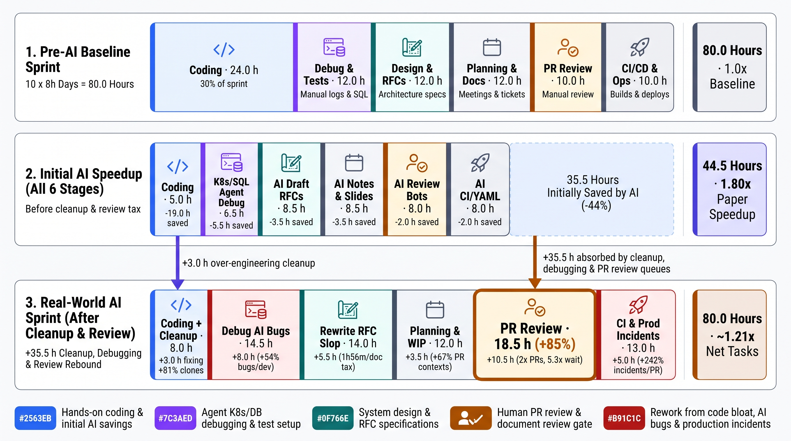
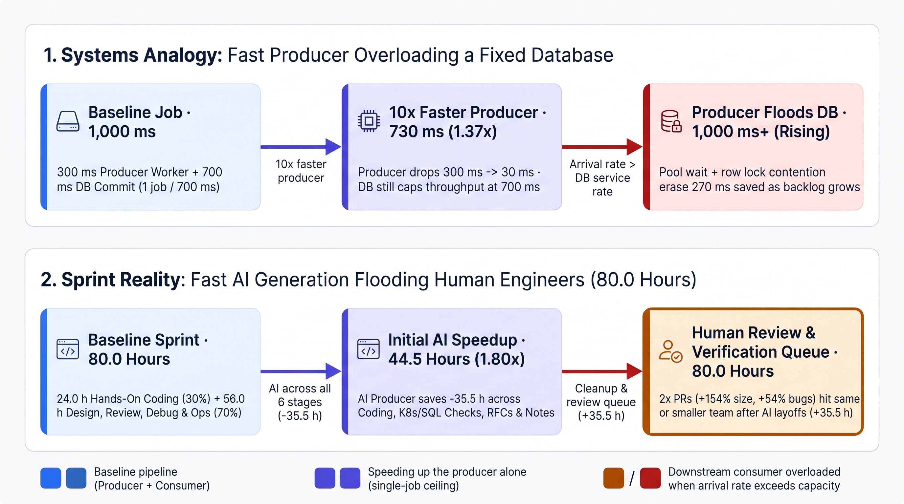
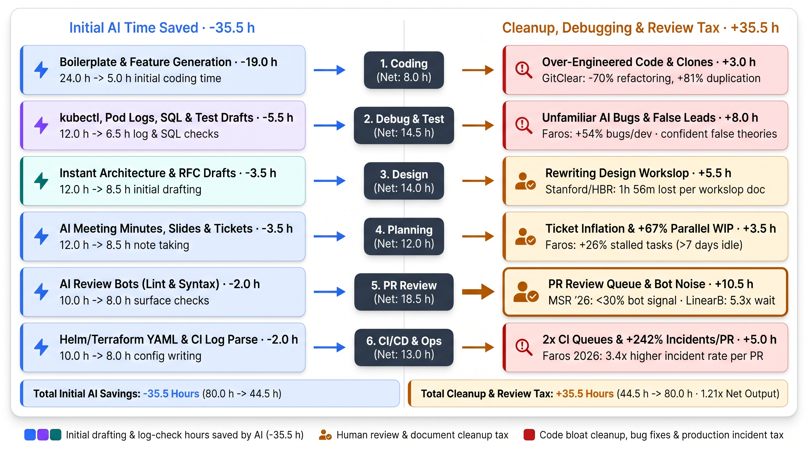
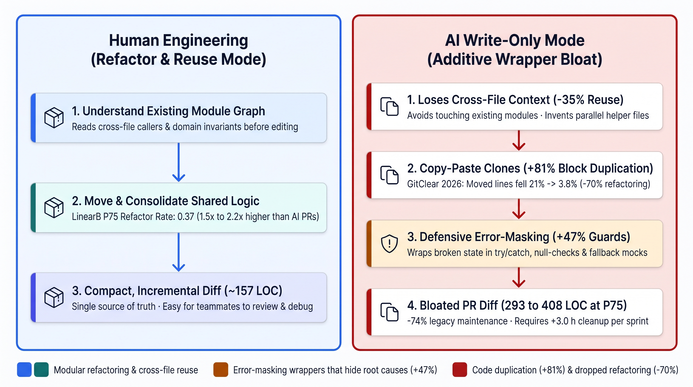
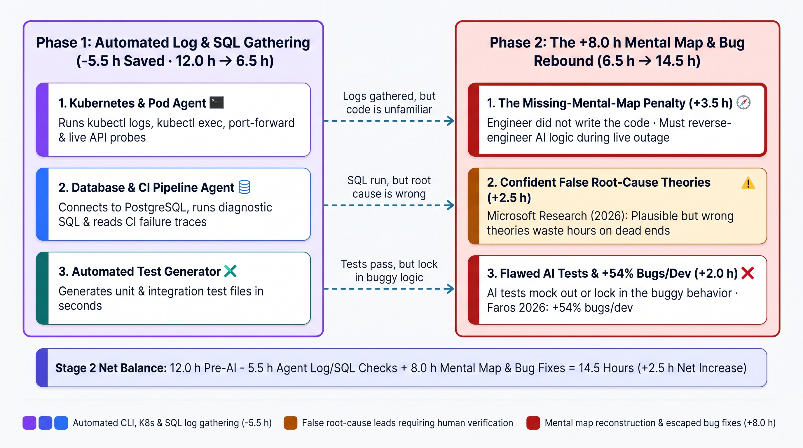
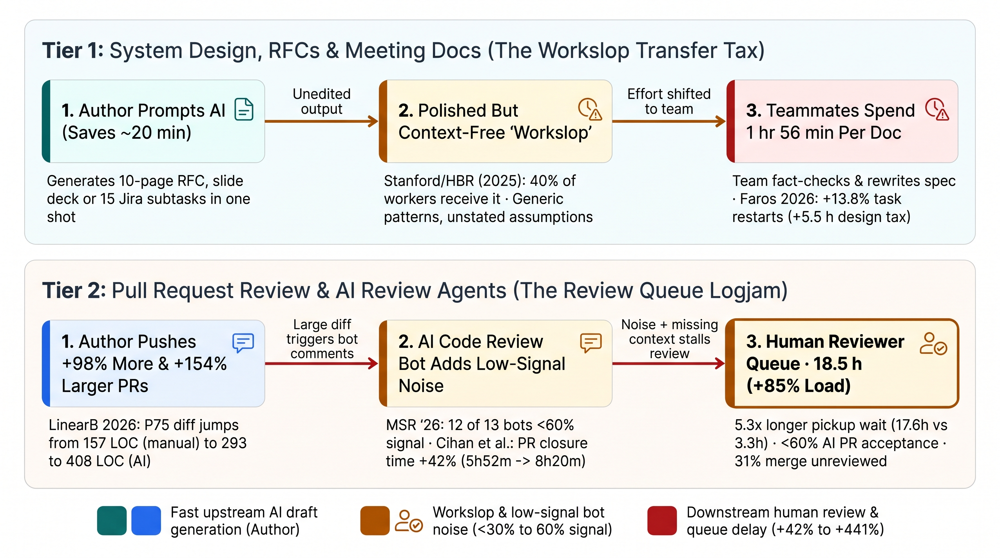
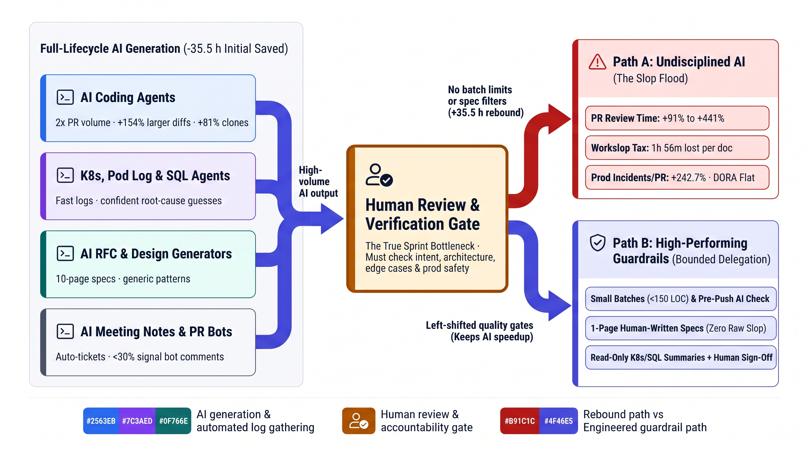
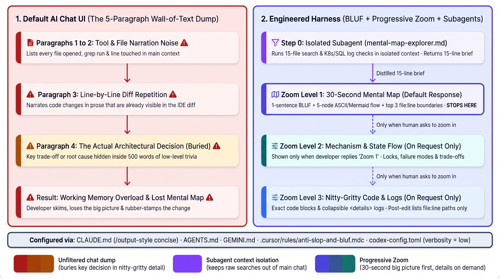
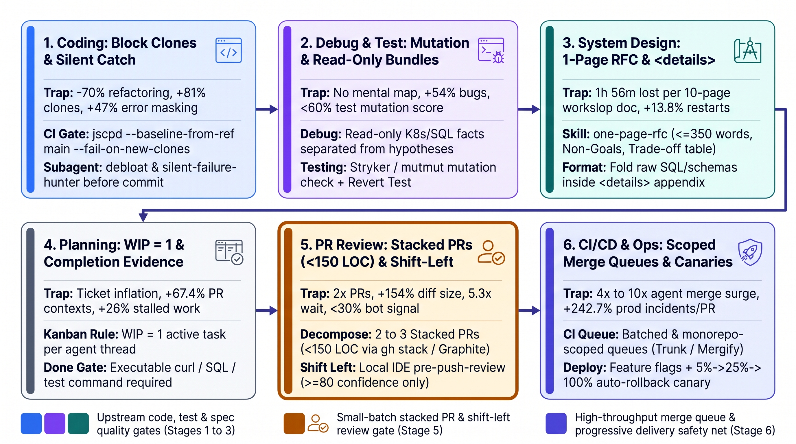

# If We Use AI for Coding, Debugging, Design, and Code Reviews, Why Isn't Our Sprint 10× Faster?

### A stage-by-stage breakdown of a two-week (`80-hour`) software engineering sprint, drawing on 2025 and 2026 industry research from GitClear, LinearB, Faros AI, Stanford, Microsoft Research, and Google DORA

When someone asks why AI coding assistants haven't made software engineering teams 10 times faster, the standard answer goes like this: *"Developers only spend 20% to 30% of their week writing code. Even if AI makes coding 10× faster, the other 70% of the sprint stays the same."*

In 2023, when AI meant single-line autocomplete inside an IDE, that explanation was good enough. In 2026, it no longer holds up.

Walk past a senior engineer's desk today and look at how they actually work. They are not just using AI to type functions. When a staging pod crashes, they do not manually dig through dashboards for an hour. Instead, they point an agent (`Claude Code`, `Cursor`, or an MCP-connected assistant) at the cluster. The agent runs `kubectl get pods`, tails the container logs, executes commands inside the pod, port-forwards the service, sends test payloads, connects to PostgreSQL, and runs diagnostic SQL queries to isolate the bad row. When a new business requirement arrives, engineers ask an LLM to draft the system design RFC and sequence diagrams. When a pull request opens, an automated AI code-review bot (`CodeRabbit`, `GitHub Copilot Review`, `Qodo`) posts comments within seconds. Even sprint planning, meeting minutes, and status slide decks are generated by AI.

Engineers now use AI across **every single stage of the software development lifecycle (SDLC)**, including coding, debugging, testing, system design, sprint planning, code review, and CI/CD operations. So why aren't engineering teams shipping 5× or 10× faster?

To answer that properly, we cannot rely on gut feelings or vendor marketing benchmarks. Instead, we can combine findings from independent industry studies published in 2025 and 2026 (including research by **GitClear**, **LinearB**, **Faros AI**, **Stanford University**, **Microsoft Research**, **METR**, and **Google Cloud DORA**) and map them onto a standard two-week (`80-hour`) engineering sprint.

When we add up the hours across all six stages of a two-week (`80-hour`) sprint, a clear pattern emerges:

1. **The initial speedup is real (`-35.5 hours` saved):** Using AI to write initial code, pull Kubernetes and database logs during debugging, draft design documents, summarize meetings, and run automated PR checks cuts the initial work from **`80.0 hours` down to `44.5 hours`**.
2. **The cleanup and review rebound eats the savings (`+35.5 hours` added back):** Because AI generates output so quickly, it also produces more code duplication, unfamiliar logic that nobody on the team wrote by hand, verbose 10-page design documents that teammates must fact-check, and **twice as many pull requests that are more than twice as large**. Reviewing, debugging, and cleaning up that output adds **`+35.5 hours` right back (`44.5 h → 80.0 h`)**.


*Figure 1: Across a two-week sprint (`10 days × 8 hours = 80.0 hours`), using AI across all six stages cuts initial drafting and debugging work to `44.5 hours` (`-35.5 h` saved), before cleaning up over-engineered code, debugging AI-introduced bugs, rewriting generic design docs, and reviewing doubled pull-request queues refill all `80.0 hours`.*

---

## 1. The Systems Engineering Mechanism: The Pipeline Bottleneck Rule

Every backend and platform engineer has seen why local speedups fail to multiply end-to-end throughput: you see the exact mechanism every time you profile a distributed system under load.

In operations research, Eliyahu Goldratt called this the **Theory of Constraints**. In systems engineering, we know it as the **Pipeline Bottleneck Rule**:

> **An end-to-end delivery pipeline only moves as fast as its slowest stage. Speeding up stages upstream of the bottleneck does not increase total system throughput. It only builds a deeper work-in-progress (WIP) queue in front of the slowest gate.**

### Stage A: Why Speeding Up One Step Hits a Hard Ceiling (`1,000 ms → 730 ms`)

Imagine a backend data job that takes **`1,000 ms`** end to end when the two steps run one after another:
- **`300 ms` (30%) in the Producer Worker:** Preparing and formatting the data in Python or Node.js.
- **`700 ms` (70%) in the Database (Consumer):** Acquiring locks, validating constraints, and committing the transaction to disk.

Suppose you rewrite the Producer Worker in Rust and make it **10× faster** (`300 ms → 30 ms`). Single-job latency does not drop to `100 ms`. It drops to **`730 ms`**:

$$\text{Speedup} = \frac{1000\text{ ms}}{30\text{ ms} + 700\text{ ms}} = \frac{1000}{730} \approx 1.37\times$$

Even if you made the Producer Worker **infinitely fast (`0 ms`)**, single-job latency is still capped at **`700 ms` (`1.43×` faster)**. And if the producer and database run concurrently as a continuous pipeline, **system throughput is set entirely by the slowest stage**: the database still finishes at most one job every `700 ms`, so overall throughput does not improve at all.

### Stage B: What Happens When Fast Producers Flood the Database (`730 ms → 1,000 ms+`)

In a real system, a 10× faster producer rarely stops at `730 ms`. The producer can now generate work far faster than the database can absorb it, and nothing upstream tells it to slow down:

1. **More jobs arrive:** Producers submit, say, `2×` as many write jobs per minute. The database was already the bottleneck, so it cannot keep up.
2. **Queues form in two places:** Jobs first wait in a queue for a free database connection once the connection pool is full, and then wait inside the database on row or table locks held by other concurrent writers.
3. **Throughput can drop:** More concurrent writers mean more lock contention, so the database finishes *fewer* jobs per second than before.

If the producer also lacks strict validation and deduplication (pushing larger batches or invalid rows that fail and retry), the load multiplies further. Because jobs now arrive faster than the database can complete them, the backlog grows continuously. The `270 ms` saved in the producer is quickly erased by connection-pool wait time and lock contention, and end-to-end latency climbs right back to **`1,000 ms` and beyond**, getting worse the longer the overload lasts.


*Figure 2: Speeding up the upstream producer by 10× hits a `1.37×` single-job latency ceiling when the downstream database is unchanged (middle), and loses that gain entirely when faster producers flood the database connection pool and lock queues faster than the database can drain them (right).*

That exact producer-consumer bottleneck is what happens inside an AI-assisted software sprint:

- **AI is the fast Producer Worker:** It generates code, Kubernetes/SQL debug checks, 10-page design docs, and meeting notes in seconds (cutting initial work from `80.0 hours` to `44.5 hours`, saving `35.5 hours`).
- **Human engineers are the Database Consumer Pool (and that pool is shrinking):** Every pull request, architecture decision, and bug fix must still pass through human brains to be understood, reviewed, and verified before shipping to production. At best, the team has the same number of engineers. In reality, many companies are using the *promise* of AI speedups to freeze hiring or lay off engineers. In our database analogy, that is like **cutting your PostgreSQL connection pool and CPU cores in half at the exact moment upstream producers start firing twice as many jobs**.
- **Volume + Quality Multiply the Queue (and Force Rubber-Stamping Into Production):** Unlike a pure Rust rewrite, AI does not just produce work faster. Without strict guardrails, it also produces much larger pull requests, more duplicated code, and more subtle bugs, all landing on a smaller team of surviving reviewers. At the same time, AI code-review bots flood those pull requests with noisy comments about minor syntax and style issues, which takes even more developer time to read and resolve and backs up the review queue further. Faced with a growing pile of large pull requests, overwhelmed engineers either rely on the AI review bot or rubber-stamp approvals without deeply reading the code. When that unreviewed code breaks in production, on-call engineers have to pull logs, build a mental map of unfamiliar AI-written code that *neither the author nor the reviewer truly understood*, and fix it under live outage pressure.

**Every claim above, including the AI layoff figures, PR review delays, bot noise ratios, and production incident rates, is backed by published 2025 and 2026 industry research and exact numbers in Sections 2 through 5 below.**

In short: when AI makes *generating* code and documents nearly free, **human review, debugging, and verification** becomes the saturated downstream bottleneck for the entire engineering team.

---

## 2. How Engineers Spent Their Week Before AI (and Why It Already Shrank From `~30%` to `~11 to 16%`)

Before modeling AI's impact on a two-week (`80-hour`) sprint, we need a clear **Pre-AI Baseline** of how software engineers spent their week *before* LLM tools existed, and how that compares to recent 2024 to 2026 studies:

- **Before AI (`2018 to 2021` studies, ~30% hands-on coding):** Even before generative AI existed, writing new code took up roughly one-third of a software engineer's week:
  - **[Sonar's 2019 Developer Survey](https://www.sonarsource.com/blog/how-much-time-do-developers-spend-actually-writing-code/):** Found that developers spent **`32%` of their workweek** actually writing or improving code. Another **`35%` of their week** went to code maintenance (`19%`), testing (`12%`), and security (`4%`), while **`23%` of their week** went to meetings and operational tasks.
  - **[Stripe's *The Developer Coefficient* Report (with Harris Poll)](https://stripe.com/files/reports/the-developer-coefficient.pdf):** Across an average `41.1-hour` workweek, developers spent **`17.3 hours` (`42%` of their week)** on maintenance, debugging, refactoring, and fixing bad code (`13.5 hours` on technical debt and `3.8 hours` on bad code), plus time for meetings, design, and code reviews, leaving roughly **`~30%` of the week** for writing new code.
  - **[Garden.io's 2021 Developer Productivity Survey (with Vanson Bourne, `n=400`)](https://resources.garden.io/hubfs/Garden_Developer_Productivity_Survey_Report_2021.pdf):** Found that engineers spent **`14.3 to 16.5 hours per week` (`35% to 40%` of their week)** just maintaining CI/CD pipelines, waiting on builds and tests, and fixing internal tooling.
- **After AI Adoption (`2024 to 2026` studies, coding shrank to `~10% to 16%`):** Once AI coding assistants sped up typing code, the share of the week spent writing code dropped to roughly **one-tenth to one-sixth of the week**, while non-coding work expanded to fill the rest of the 80-hour sprint:
  - **[Microsoft Research's *Time Warp* Study (2024, `n=482` developers)](https://www.microsoft.com/en-us/research/wp-content/uploads/2024/11/Time-Warp-Developer-Productivity-Study.pdf):** Tracking actual workweeks showed that writing code took up just **`~11%` of a developer's week** (compared to `~20%` in their "ideal" week), alongside meetings and communication (`~12%`), debugging (`~9%`), system design (`~6%`), pull request reviews (`~5%`), testing, and operations.
  - **[Atlassian's 2025 State of DevEx Report](https://www.atlassian.com/blog/bitbucket/devex-bitbucket-pipelines-versus-jenkins) (surveying thousands of developers):** Developers reported spending only **`16%` of their workweek writing code**, while the other **`84%` of their week** went to searching for context, reviewing code, debugging, attending meetings, and fixing technical debt. Half of the surveyed developers (`50%`) said they lose **more than 10 hours every week** to organizational and tooling delays.
  - **[A 2026 study from Oregon State University and Microsoft Research](https://arxiv.org/pdf/2604.07830) (*"To Copilot and Beyond"*, surveying `860` Microsoft engineers):** Confirmed that writing code now takes up roughly **one-tenth (`~10%`) of a developer's day**, while the remaining **`~90%` of their day** is spent debugging incidents, reviewing pull requests, updating documentation, and aligning designs.

Notice how those two sets of studies already tell the story: **before AI, hands-on coding was `~30%` of the sprint (`24.0 hours` out of `80.0 hours`, or 3 days out of 10), and after AI it shrank to `~10%` (`8.0 hours` out of `80.0 hours`), while the total 80-hour sprint stayed completely full.** Let us use that exact **`30%` (`24.0 hours`) Pre-AI baseline** from the pre-AI studies and trace where every hour goes across all six stages of the sprint.

---

## 3. The 80-Hour (`10 × 8h`) Two-Week Sprint Model: Initial Speedup vs. Net Reality

Let us model a standard two-week sprint (**10 working days × 8 hours = 80.0 hours per engineer**) across four scenarios:
1. **Pre-AI Baseline (`80.0 h`):** Traditional engineering workflow before AI assistants.
2. **Naive "Coding-Only" 10× Math (`58.4 h`):** The classic thought experiment where only coding speeds up by 10× (`24.0 h → 2.4 h`) and nothing else changes (`80.0 / 58.4 = 1.37×`).
3. **Initial AI Speedup Across All 6 Stages (`44.5 h`):** What happens when an engineer uses modern AI agents across **all six stages** of the sprint, measuring only the initial time saved while generating code, pulling logs, and drafting docs (`-35.5 hours` saved, or **`1.80×` faster** on paper before cleanup).
4. **Real-World AI Sprint After Cleanup & Review (`80.0 h`):** What happens once the **cleanup, debugging, and review rebound (`+35.5 hours`)** hits each stage.

| Sprint Stage (10 × 8h = 80h) | 1. Pre-AI Baseline | 2. Initial AI Speedup (All 6 Stages) | 3. Cleanup, Rework & Review Tax | 4. Net Real-World AI Sprint | Net Change vs. Pre-AI |
|---|---|---|---|---|---|
| **1. Hands-on coding & refactoring** | `24.0 h` (`30.0%`) | `5.0 h` (`-19.0 h` saved) | `+3.0 h` (cleaning up duplicate/bloated code) | **`8.0 h`** (`10.0%`) | **`-16.0 h` (`-67%`)** |
| **2. Debugging, K8s/DB investigation & tests** | `12.0 h` (`15.0%`) | `6.5 h` (`-5.5 h` saved) | `+8.0 h` (unfamiliar code, `+54%` bugs) | **`14.5 h`** (`18.1%`) | **`+2.5 h` (`+21%`)** |
| **3. System design & architecture RFCs** | `12.0 h` (`15.0%`) | `8.5 h` (`-3.5 h` saved) | `+5.5 h` (`1h 56m` doc cleanup, restarts) | **`14.0 h`** (`17.5%`) | **`+2.0 h` (`+17%`)** |
| **4. Sprint planning, meetings & slides** | `12.0 h` (`15.0%`) | `8.5 h` (`-3.5 h` saved) | `+3.5 h` (ticket bloat, `+67%` PR WIP) | **`12.0 h`** (`15.0%`) | **`0.0 h` (`0%`)** |
| **5. PR code review & approval gate** | `10.0 h` (`12.5%`) | `8.0 h` (`-2.0 h` saved) | `+10.5 h` (`2×` PRs, `+154%` size, bot noise) | **`18.5 h`** (`23.1%`) | **`+8.5 h` (`+85%`)** |
| **6. CI/CD pipelines, deploy & prod ops** | `10.0 h` (`12.5%`) | `8.0 h` (`-2.0 h` saved) | `+5.0 h` (CI queues, `+242.7%` incidents) | **`13.0 h`** (`16.3%`) | **`+3.0 h` (`+30%`)** |
| **Total Sprint Time / Net Output** | **`80.0 h` (`1.00×`)** | **`44.5 h` (`1.80×` paper)** | **`+35.5 h` rebound** | **`80.0 h` (`~1.21×` tasks)** | **Bottleneck shifted** |


*Figure 3: Every stage of the sprint sees genuine initial time savings from AI tools (`-35.5 hours` on the left), which is offset by a stage-specific cleanup, debugging, and review rebound (`+35.5 hours` on the right).*

---

## 4. Deep Dive: What Speeds Up and What Breaks in Every Stage of the Sprint

Let us examine the mechanics and published research behind each of the six stages.

---

### 4.1 Stage 1: Hands-On Coding (`24.0 h → 5.0 h Initial → 8.0 h Net`)

**What it is:** Writing new application logic, data models, API endpoints, migrations, and refactoring existing modules inside the IDE.

#### Where AI Speeds Things Up (`-19.0 hours`)
Coding assistants and autonomous IDE agents (`Cursor`, `Claude Code`, `GitHub Copilot`, `Windsurf`) dramatically cut the time required to turn a clear specification into working code. Writing boilerplate, CRUD endpoints, data transformations, and SDK integrations drops from `24.0 hours` to roughly **`5.0 hours`** of prompting, providing context, and steering (`-19.0 hours` saved).

#### Why It Rebounds (`+3.0 hours` Cleanup Tax + Downstream Technical Debt)
When a senior engineer adds a feature to an existing service by hand, they typically inspect neighboring files, extract shared logic into a common helper, and update existing functions in place (**refactoring**).

LLMs do not naturally work that way. An LLM's context window is finite, and modifying shared functions carries a risk of breaking callers outside that window. As a result, **AI strongly favors additive, "write-only" code**. It leaves existing functions untouched, duplicates blocks across files, wraps calls in redundant abstraction layers, and silences errors with defensive `try/catch` blocks or fallback mocks.

Two large multi-year code-quality studies quantified this shift in 2025 and 2026:

- **[GitClear's 2026 Maintainability Gap study](https://www.gitclear.com/the_ai_code_quality_maintainability_gap) (in which GitClear analyzed 623 million code changes from 2023 to 2026, building on [their 2025 study of 211 million lines](https://www.gitclear.com/ai_assistant_code_quality_2025_research)):**
  - **Refactoring dropped by `70%`:** The share of changed lines classified as "moved" (which happens when developers extract and reuse shared functions) fell from **`21.0%` of all code changes in 2022** down to **`3.8%` in 2026**.
  - **Updating existing legacy code dropped by `74%`** compared to 2022, and **reusing functions across files fell by `35%`**.
  - **Duplicated code blocks jumped by `81%`:** Repeated blocks of five or more identical lines hit an all-time high (`73.0` duplicate blocks per million changed lines, up from `40.3`), while **copy-pasting code within the same commit rose by `41%`** (growing from `9.4%` of changed lines to `15.7%`). Developers are now **roughly 5× more likely** to copy-paste duplicate code than to refactor shared logic.
  - **Error-hiding wrappers rose by `47%`:** [GitClear's live signal graphs](https://www.gitclear.com/industry_stats/ai_code_quality_signal_graphs) show that AI commits contain **`47%` more defensive error-masking code** (`try/catch` blocks that swallow exceptions, null-guards, and fallback mocks) that hide broken state instead of failing loudly.
  - **Early code rewrites ("churn") rose by `15%`:** More newly written lines have to be reverted or rewritten within 14 days of being merged.
- **[LinearB's 2026 Software Engineering Benchmarks Report](https://assets.linearb.io/image/upload/v1765300694/resources/LinearB_2026_Software_Engineering_Benchmarks_Report.pdf) (in which LinearB studied 8.1 million pull requests across 4,813 engineering teams):**
  - **Human PRs do `1.5×` to `2.2×` more refactoring than AI PRs:** In human-written pull requests (at the 75th percentile), **`37%` of the changed lines** involved refactoring existing code, compared to only **`22%` in AI-assisted PRs** and **`17%` in fully agent-generated PRs**.
  - **AI pull requests are `87%` to `160%` larger:** Human-written pull requests modified **`157 lines of code`** (at the 75th percentile), whereas agent-generated PRs modified **`293 lines`** and AI-assisted PRs modified **`408 lines`**.

As one engineer (`P208`) in the [2026 Microsoft Research and Oregon State University study](https://arxiv.org/pdf/2604.07830) put it:
> *"We want/need [AI] to do a MUCH better job of analyzing a current code base, architecture, and structure so it can understand how/where to add/extend. Today it loves to duplicate code, and even break existing functionality."*

Even when a careful engineer spends **`+3.0 hours`** during coding to strip out dead wrappers and collapse duplicate helpers (bringing net coding time to **`8.0 hours`**, still a **`3.0×` speedup** over `24.0 hours`), the remaining code bloat flows directly into Debugging (Stage 2) and PR Review (Stage 5).


*Figure 4: Human engineers consolidate shared logic (`0.37` refactor rate, `157 LOC` at P75 in LinearB's dataset), whereas AI coding tools default to additive "write-only" generation (`-70%` refactoring, `+81%` block duplication, `+47%` error-masking guards, and `293 to 408 LOC` diffs in GitClear and LinearB data).*

In short: AI makes writing initial code `~3×` to `5×` faster, but shifts the codebase from modular refactoring to copy-paste duplication.

---

### 4.2 Stage 2: Debugging, K8s/DB Investigation & Testing (`12.0 h → 6.5 h Initial → 14.5 h Net`)

**What it is:** Investigating staging and production bugs, inspecting Kubernetes pods and logs, querying databases, reproducing failures, and writing unit and integration tests.

#### Where AI Speeds Things Up (`-5.5 hours`)
Modern engineers rarely debug from a blank terminal. Using CLI agents (`Claude Code`, `Cursor` agent mode, or custom MCP servers), an engineer can paste a stack trace or alert and let the agent:
1. Run `kubectl get pods`, `kubectl describe`, and `kubectl logs` across namespaces.
2. Execute diagnostic commands inside containers (`kubectl exec`) or open local port-forwards (`kubectl port-forward`) to curl live endpoints.
3. Connect to staging or read-replica databases, inspect table schemas, and run SQL queries to check data state.
4. Read CI/CD failure logs and generate unit or integration test files.

Automating this log-gathering and test-setup work cuts initial investigation time nearly in half, from `12.0 hours` down to **`6.5 hours` (`-5.5 hours` saved)**. In [Microsoft Research's 2026 survey of 860 engineers](https://arxiv.org/pdf/2604.07830), **`40.6%` of infrastructure engineers** and **`19.5%` of application developers** ranked automated log and incident gathering as one of the most helpful uses of AI: *"There are lots of logistics that need to be done... if those are done by AI, it would be a great win."*

#### Why It Rebounds (`+8.0 hours` from Unfamiliar Code, False Leads & Escaped Bugs)
If AI makes pulling logs and scaffolding tests `5.5 hours` faster, why does total debugging and testing time *increase* from `12.0 hours` to **`14.5 hours` (`+2.5 hours` net)**? Three factors drive an **`+8.0 hour` rebound**:

1. **The Missing-Mental-Map Penalty (`+3.5 hours`):**
   When you write a 300-line service by hand, you build an internal mental map of its state transitions, locking assumptions, and edge cases while typing. When an AI agent writes those 300 lines in 30 seconds, **nobody on the team has that mental map**. When a subtle race condition or data-corruption bug triggers in staging three days later, you are not debugging *your* code. You are reverse-engineering a stranger's code under incident pressure. Worse, because [GitClear's 2026 study](https://www.gitclear.com/the_ai_code_quality_maintainability_gap) found AI increases **error-masking wrappers by `+47%`** (swallowed exceptions and silent fallback values), the crash happens far downstream from where the state actually went wrong.
2. **Confident Root-Cause Hallucinations (`+2.5 hours`):**
   Agents are fast at collecting `kubectl` logs and SQL rows, but unreliable at causal root-cause reasoning across distributed services. When an agent correlates three log lines and presents a plausible-sounding (but wrong) root-cause theory with 100% confidence, engineers waste hours chasing a dead end. As one Microsoft engineer (`P223`) explained in the [To Copilot and Beyond study](https://arxiv.org/pdf/2604.07830):
   > *"AI is very bad at understanding the context and throwing wrong answers with utmost confidence, makes us waste time instead of helping."*
3. **Self-Passing Unit Tests & Rising Bug Rates (`+2.0 hours`):**
   In that same [Microsoft Research study](https://arxiv.org/pdf/2604.07830), **`44.5%` of respondents** in the testing track pointed out a common trap in AI test generation. When you ask an LLM to write unit tests for code it just generated, it reads the implementation (including its bugs) and writes tests that lock in the buggy behavior, or mocks out the exact database/network boundary where the bug lives. The test suite shows `100%` green passing checks in CI while letting real bugs slip through.
   - **Rising Bug Rates in Industry Studies:** In [Faros AI's July 2025 study of 10,000+ developers](https://243608892.fs1.hubspotusercontent-na2.net/hubfs/243608892/AI_Engineering_Impact_Report_July_2025_Faros_AI.pdf), high AI adoption correlated with a **`+9%` increase in bugs per developer**. In [Faros AI's 2026 follow-up study across 22,000 developers](https://www.faros.ai/blog/key-takeaways-from-the-dora-report-2025), **bugs per developer climbed to `+54%`**.


*Figure 5: Agents save `5.5 hours` automating `kubectl`, pod logs, SQL queries, and test setup (left), but add `8.0 hours` back because engineers must debug unfamiliar AI code without a mental map, check confident false root-cause theories, and fix `+54%` more bugs (right).*

In short: AI agents automate the *legwork* of debugging (`kubectl`, SQL, log search), but AI-written code produces `54%` more bugs that take longer to diagnose because no human holds the mental model.

---

### 4.3 Stage 3: System Design & Architecture RFCs (`12.0 h → 8.5 h Initial → 14.0 h Net`)

**What it is:** Translating business requirements into system architecture, API contracts, database schemas, Request for Comments (RFC) design documents, and trade-off analyses.

#### Where AI Speeds Things Up (`-3.5 hours`)
Instead of staring at a blank page, an engineer feeds product requirements and existing schema files into an LLM and asks for an RFC draft, sequence diagrams, and failure-mode tables. Initial drafting drops from `12.0 hours` to **`8.5 hours` (`-3.5 hours` saved)**.

#### Why It Rebounds (`+5.5 hours` "Workslop" & Spec-Restart Tax)
Here we run into a problem documented in recent workplace research: **AI-generated "workslop."**

In September 2025, researchers from **Stanford University's Social Media Lab and BetterUp Labs** published a [study in *Harvard Business Review*](https://hbr.org/2025/09/ai-generated-workslop-is-destroying-productivity) (with full details in the [BetterUp and Stanford research report](https://www.betterup.com/hubfs/Post-Uplift%20content/BetterUp_Uplift_The%20hidden%20cost%20of%20workslop.pdf)) surveying **1,150 full-time U.S. desk workers**:

- **What "Workslop" Means:** AI-generated content (such as design documents, technical reports, slide decks, summaries, and code) that looks polished, structured, and complete at a glance, but lacks the project-specific context, constraints, and substance required to actually move the work forward.
- **How Common It Is:** **`40%` of surveyed employees** reported receiving "workslop" from coworkers in the past month, **`53%` of employees** admitted to sending it themselves at least occasionally, and employees estimated that **`15.4%` of all work they receive** at their company is now AI-generated workslop.
- **The Transfer Tax (`1 hour 56 minutes` per incident):** As the Stanford and BetterUp researchers explain, *"The insidious effect of workslop is that it shifts the burden of the work downstream, requiring the receiver to interpret, correct, or redo the work. In other words, it transfers the effort from creator to receiver."* On average, teammates on the receiving end spent **1 hour and 56 minutes per workslop document** reading, fact-checking, and rewriting the material.
- **Impact on Team Trust:** Over half of the people who received workslop said it damaged their opinion of the sender: **`54%` of recipients** viewed the sender as less creative, **`50%` of recipients** saw them as less capable, **`49%`** saw them as less reliable, and **`42%`** trusted them less.

In software architecture, design workslop is especially expensive:
- **Generic Textbook Patterns & Unstated Assumptions:** In [Microsoft Research's 2026 study](https://arxiv.org/pdf/2604.07830), engineers noted that when asked to design a system, LLMs default to verbose, generic patterns that ignore local infrastructure constraints (*"AI would probably fall back to using the same known pattern regardless of the design particularities. That makes the designs inefficient"*) and silently invent requirements or assume guarantees that do not exist.
- **`+13.8%` More Task Restarts:** When an engineer prompts a 10-page RFC in 10 minutes without thinking through edge cases, teammates either spend hours in design review stripping out filler and checking assumptions, or approve it superficially. [Faros AI’s 2026 study](https://www.faros.ai/blog/key-takeaways-from-the-dora-report-2025) found that **task restarts** (tickets that move backward to *in-progress* after hitting an architectural dead end) **increased by `+13.8%`**.

Fact-checking and rewriting bloated AI RFCs (`~2 hours` per doc across 2 to 3 specs per sprint) plus re-architecting restarted tasks adds **`+5.5 hours`** back, pushing net design time from `12.0 hours` to **`14.0 hours` (`+2.0 hours` net increase)**.

In short: prompting a 10-page design doc saves the author 30 minutes and costs the rest of the engineering team 2 hours to read, fact-check, and rewrite.

---

### 4.4 Stage 4: Sprint Planning, Meetings & Presentations (`12.0 h → 8.5 h Initial → 12.0 h Net`)

**What it is:** Sprint planning, backlog refinement, daily standups, writing meeting minutes, preparing architecture/demo slide decks, and updating documentation.

#### Where AI Speeds Things Up (`-3.5 hours`)
AI meeting transcription bots summarize 60-minute calls automatically, presentation tools generate slide decks from bullet points, and task agents break high-level epics into Jira subtasks. That trims roughly **`3.5 hours`** of manual note-taking and slide formatting (`12.0 h → 8.5 h`).

#### Why It Rebounds (`+3.5 hours` Document Inflation & Multi-Agent Context Switching)
All `3.5 hours` saved in creating notes and tickets are consumed by two new coordination taxes:

1. **Ticket & Documentation Inflation:**
   When generating Jira tickets, status reports, and wiki pages takes zero effort, volume explodes. Instead of a concise 5-line ticket or a 4-bullet meeting decision log, engineers face 15 auto-generated subtasks and 3-page AI meeting summaries where key decisions are buried inside generic filler. In the [2026 Microsoft Research survey](https://arxiv.org/pdf/2604.07830), **`45.9%` of respondents** in the Meta-Work track flagged documentation drift and AI doc bloat as a major pain point:
   > *"Unfortunately, I think right now the focus is on just generating a bunch of AI slop that nobody will ever read or maintain, which just makes all the documentation problems we have now even worse."*
2. **Parallel Workstream Explosion (`+67.4%` PR Contexts & `+26%` Stalled Work):**
   Because coding agents can run in the background, developers spin up multiple tasks at the same time. [Faros AI’s 2025 and 2026 studies](https://www.faros.ai/blog/key-takeaways-from-the-dora-report-2025) measured the cost of this multitasking:
   - Developers on high-AI teams interact with **`+47%` more PRs per day** in 2025, rising to **`+67.4%` more PR contexts** and **`+17.7%` more task contexts per day** in 2026.
   - **Stalled tasks (`7+ days` in-progress with zero PR activity) jumped `+26%`**. Starting work with an AI agent is easy. Finishing, integrating, and shipping all those parallel threads requires extra standup coordination, blocker triage, and re-planning (`+3.5 hours`), leaving net planning and meeting time right back at **`12.0 hours` (`0.0 h` net savings)**.

In short: AI writes the meeting notes and Jira tickets faster, but managing `+67%` more parallel work-in-progress and `+26%` more stalled tickets eats every minute saved.

---

### 4.5 Stage 5: PR Code Review & AI Review Bots (`10.0 h → 8.0 h Initial → 18.5 h Net`)

**What it is:** Reviewing teammates' pull requests, responding to review comments, verifying business logic and security, and waiting for merge approval.

*"Wait,"* many engineers ask, *"if human PR review is the bottleneck, don't AI code review agents (`CodeRabbit`, `GitHub Copilot Review`, `Qodo`, `Cursor Bugbot`, `Greptile`) automate code reviews too?"*

Let us look at what happened when researchers measured AI code review agents (`CRAs`) in real repositories in 2025 and 2026.

#### Where AI Speeds Things Up (`-2.0 hours`)
AI code review bots are genuinely helpful as a **first-pass checker**. They summarize diffs, flag obvious null-pointer risks, catch missing error checks, and point out style violations before a human reviewer looks at the PR (`-2.0 hours` saved, `10.0 h → 8.0 h`). In controlled deployments with strict noise filtering, such as the [DeputyDev double-controlled A/B study at TATA 1mg across 200 engineers](https://arxiv.org/html/2508.09676), contextual pre-review reduced per-line review duration.

#### Why It Explodes (`+10.5 hours` from Bot Noise + `2×` Volume + `+154%` Size + `5.3×` Pickup Wait)
Across the broader industry, three independent studies show why PR code review has become the **#1 bottleneck in modern software engineering**, climbing from `10.0 hours` to **`18.5 hours` (`+85%` increase)** per sprint:

1. **[An April 2026 MSR study of 3,109 Pull Requests](https://arxiv.org/html/2604.03196) (*"From Industry Claims to Empirical Reality: An Empirical Study of Code Review Agents in Pull Requests"*):**
   Researchers analyzed `19,450` review records across `3,109` pull requests from the `AIDev` dataset:
   - Vendor marketing claimed AI review bots could handle `80%` of pull requests without human involvement. In reality, pull requests reviewed only by AI bots were approved and merged **`45.20%` of the time**, compared to **`68.37%` for human-reviewed pull requests**, and **`34.88%` of bot-reviewed PRs were abandoned** (versus `21.60%` for human-reviewed PRs).
   - Why? Because most bot comments were noise. In **`60.2%` of closed bot-reviewed pull requests**, **fewer than 1 in 3 bot comments (`0% to 30%`) pointed to a real bug, security flaw, or design issue**. Out of 13 AI code-review bots tested, **12 bots had a useful-comment rate below `60%`** (for example, only `19.8%` of comments from `GitHub Copilot Review`, `27.6%` from `GitHub Advanced Security Bot`, and `43.4%` from `Cursor Bot` led to actual code fixes).
   - A [companion MSR 2026 study of 7,416 reviewer-bot comments across 4,532 pull requests](https://dl.acm.org/doi/abs/10.1145/3793302.3793599) confirmed that **the more comments an AI review bot posts on a pull request, the longer that pull request takes to merge**.
2. **[An industrial study of 4,335 Pull Requests by Bilkent University and Beko](https://arxiv.org/html/2412.18531v2) (*"Automated Code Review In Practice"*):**
   Researchers studied **238 developers across 10 industrial projects and 4,335 pull requests** (`1,568` of which were reviewed by an LLM code-review bot built on Qodo PR-Agent and GPT-4):
   - Even though developers marked `73.8%` of the bot's comments as resolved, **average pull request merge time took `42%` longer after introducing the bot, rising from `5 hours 52 minutes` to `8 hours 20 minutes`**.
   - Developers reported that reading, arguing with, or making unnecessary code edits just to satisfy context-blind bot comments slowed down their reviews.
3. **[Faros AI's 22,000-developer study](https://www.faros.ai/blog/key-takeaways-from-the-dora-report-2025) & [LinearB's 8.1M PR benchmarks](https://assets.linearb.io/image/upload/v1765300694/resources/LinearB_2026_Software_Engineering_Benchmarks_Report.pdf):**
   Because AI coding tools allow developers to open **nearly twice as many pull requests (`+98%`)** that are **more than twice as large (`+154%` more lines changed)**, human reviewers get buried:
   - **Time spent in PR review jumped by `91%`** in [Faros AI's 2025 report](https://243608892.fs1.hubspotusercontent-na2.net/hubfs/243608892/AI_Engineering_Impact_Report_July_2025_Faros_AI.pdf) (`10,000+` developers) and **jumped by `441%` (more than 5× longer median review time)** in [Faros AI's 2026 report](https://www.faros.ai/blog/key-takeaways-from-the-dora-report-2025) (`22,000` developers).
   - **PRs wait `5.3×` longer for a reviewer to open them:** [LinearB's 2026 study of 8.1M PRs](https://assets.linearb.io/image/upload/v1765300694/resources/LinearB_2026_Software_Engineering_Benchmarks_Report.pdf) found that pull requests written by AI agents sit untouched in the review queue for **`17.6 hours` (`1,055 minutes` at the 75th percentile)** before a human reviewer even opens them, compared to **`8.3 hours` (`496 minutes`)** for AI-assisted PRs and just **`3.35 hours` (`201 minutes`)** for human-written PRs.
   - **Much lower approval rates:** LinearB found that **`84.4%` of human-written pull requests get approved and merged**, whereas **only `32.7%` of AI-generated pull requests get merged**. Engineering leaders surveyed by LinearB explained why:
     > *"AI generates advanced code the author could not explain."*
     > *"Without context it generates more work than a junior developer. The workload increases for the reviewer."*
4. **Shrinking Reviewer Pools From AI-Justified Layoffs & Hiring Freezes:**
   To make this review logjam even worse, the number of human reviewers on the team is often shrinking rather than growing. Believing that AI makes engineering teams multiple times faster, many companies have frozen hiring or laid off developers:
   - **[LeadDev's 2025 AI Impact Report](https://leaddev.com/wp-content/uploads/2025/08/THE-AI-IMPACT-REPORT-2025-download__LDMO__.pdf) (surveying `883` engineering leaders and developers):** Found that **`26%` of surveyed companies had already reduced or combined their engineering teams** after adopting AI, and **`54%` of surveyed engineering leaders predicted that companies will hire fewer junior developers** in the future.
   - **[Challenger, Gray & Christmas Job Cut Reports (2025 & 2026)](https://www.challengergray.com/wp-content/uploads/2026/01/Challenger-Report-December-2025.pdf) & [The Counting AI Layoffs Register](https://ailayoffs.org/research/counting-ai-layoffs-2026-10.pdf) (tracking 243 layoff events from 2023 to 2026):** U.S. employers cited AI as the reason for **`54,836` announced job cuts in 2025** (out of `154,445` total tech job cuts) and over **`120,000` AI-cited job cuts through September 2026**, with **software engineering and IT roles cut most often**.
   - When a company reduces its engineering headcount while the remaining developers use AI to open twice as many pull requests that are more than twice as large, every surviving engineer is left with a much deeper review, debugging, and on-call queue.


*Figure 6: In both system design (top) and pull request review (bottom), AI makes generating drafts effortless for the author while shifting a heavy review and noise-filtering burden onto teammates (`1h 56m` per workslop doc; `<30%` bot signal; `5.3×` longer PR pickup wait; `+91%` to `+441%` longer review cycles).*

In short: AI code review bots cannot approve architectural intent, noisy bot comments add `+42%` to PR closure time, and human reviewers face `2×` as many PRs that are `154%` larger. That nearly doubles sprint review hours (`10.0 h → 18.5 h`).

---

### 4.6 Stage 6: CI/CD Pipelines, Deployments & Production Ops (`10.0 h → 8.0 h Initial → 13.0 h Net`)

**What it is:** Maintaining CI/CD workflows, waiting on build/test pipelines, resolving merge conflicts, deploying releases, and handling on-call production incidents.

#### Where AI Speeds Things Up (`-2.0 hours`)
AI assistants save roughly **`2.0 hours`** per sprint (`10.0 h → 8.0 h`) by generating GitHub Actions workflows, Dockerfiles, Helm charts, and Terraform configurations, and by summarizing long CI build failure logs. In [Microsoft Research's 2026 developer survey](https://arxiv.org/pdf/2604.07830), `33.7%` of infrastructure respondents specifically requested CI/CD blueprint and log-diagnosis assistants.

#### Why It Rebounds (`+5.0 hours` CI Queue Contention & `+242.7%` Production Incidents)
1. **CI Pipeline Contention & Merge Conflicts (`+2.0 hours`):**
   When a team merges **`+98%` more PRs** that touch more files per commit (`4.95` to `7.51` files and `293 to 408` lines at P75 in [LinearB's 2026 report](https://assets.linearb.io/image/upload/v1765300694/resources/LinearB_2026_Software_Engineering_Benchmarks_Report.pdf)), CI build queues back up, integration test suites run twice as often, and branches fall out of date faster. Engineers spend extra hours rebasing and resolving merge conflicts.
2. **The "Acceleration Whiplash" in Production (`+3.0 hours`):**
   What happens when reviewers are overwhelmed by `2×` PR volume and `154%` larger diffs? LinearB's survey and [Faros AI's 2026 study](https://www.faros.ai/blog/key-takeaways-from-the-dora-report-2025) captured the exact failure mode: **reviewer fatigue leads to rubber-stamping.**
   - In Faros AI's 2026 study across `22,000` developers, **`31%` more PRs merged with zero human review at all**.
   - As a direct consequence, **production incidents per PR jumped `+242.7%`**. Every merged code change is now **more than `3.4×` as likely to trigger a production incident**.

On-call incident triage, hotfixes, and rollbacks add **`+3.0 hours`** per sprint, bringing net CI/CD and production ops time from `10.0 hours` to **`13.0 hours` (`+3.0 hours` net increase)**.

In short: AI helps write the YAML, but pushing twice as many oversized, lightly reviewed PRs through CI/CD triples the production incident rate per PR.

---

## 5. The Perception Gap: Why `1.21×` Feels Like `10×`

Net completed tasks per sprint only rise by **`+21%` to `+34%` (`1.21× to 1.34×`)**, and company-wide DORA delivery metrics remain flat or suffer stability whiplash. So why do so many developers sincerely feel like they are moving `5×` or `10×` faster?

In [a July 2025 randomized controlled trial by METR](https://metr.org/blog/2025-07-10-early-2025-ai-experienced-os-dev-study/) (with [a February 2026 follow-up](https://metr.org/blog/2026-02-24-uplift-update/)), researchers ran a controlled experiment with experienced open-source developers:
- **Study Design:** 16 experienced maintainers working on large, mature open-source repositories they knew deeply (averaging **`22,000+` GitHub stars** and **`1,000,000+` lines of code**) completed **246 real repository issues** (features, bug fixes, refactors averaging 2 hours each). Issues were randomly assigned to either allow frontier AI tools (primarily `Cursor Pro` with `Claude 3.5/3.7 Sonnet`) or disallow AI, with full screen recording.
- **The Perception vs. Reality Gap:**
  - **Before starting:** Developers forecasted that AI would speed them up by **`+24%`**.
  - **After finishing:** Even after completing the tasks, developers believed AI had sped them up by **`+20%`**.
  - **Actual Stopwatch Time:** In the early-2025 trial, developers using AI actually took **`19% longer`** to complete issues than when working without AI (in the [February 2026 follow-up cohort](https://metr.org/blog/2026-02-24-uplift-update/), measured speedup shifted to **`4% to 18% faster`**, still nowhere near `2×` or `10×`).

Why do smart engineers misjudge their own stopwatch time by `35` to `40` percentage points?

1. **Generating Feels Fast; Reviewing and Fixing Feels Invisible:**
   Watching an agent generate 400 lines of code, a 10-page RFC, or a complex SQL query in 15 seconds feels effortless. Your brain anchors on the 15-second generation burst (`44.5 hours`). You do not mentally bill "AI" when you spend 45 minutes two days later untangling a subtle race condition, resolving a noisy bot comment, or fixing a broken test (`+35.5 hours`).
2. **Mechanical vs. Deep-Thinking Work:**
   A [UC Berkeley eye-tracking study highlighted by Google Cloud DORA](https://dora.dev/insights/customization-supports-developer-engagement/) found that developers gave **`19%` of their visual attention** to AI chat during mechanical tasks (writing boilerplate, installing packages), but **less than `1%` visual attention** during complex code understanding tasks. When deep comprehension was required, engineers chose to read and reason manually to stay in control.
3. **Bounded Delegation:**
   In [Microsoft Research's 2026 paper](https://arxiv.org/pdf/2604.07830), the authors call this boundary **"bounded delegation"**: developers want AI to handle the *setup and legwork surrounding their craft* (collecting logs, scaffolding tests, formatting docs), while keeping human ownership over *architectural judgment, design trade-offs, and production sign-off*.

---

## 6. The Engineering Playbook: How to Keep the `35.5 Hours` AI Saves

The findings from Faros AI, LinearB, GitClear, and DORA make one thing clear: **the `35.5 hours` of initial AI time savings across an 80-hour sprint are real.** Teams lose those `35.5 hours` because they deploy `10×` generation tools without engineering guardrails for **verbose AI chat responses, PR batch size, code reuse, or document bloat**.


*Figure 7: Without guardrails, full-lifecycle AI generation floods the human review gate and triggers the cleanup and review rebound (Path A, top right). High-performing engineering teams enforce practical guardrails across all six stages to keep the hours AI saves (Path B, bottom right).*

### 6.1 Stopping Verbose "Walls of Text" Inside Your Coding Assistant

The "workslop" problem does not start when someone opens a 10-page RFC or a 400-line pull request. **It starts inside your own IDE chat pane.**

By default, coding assistants (`Claude Code`, `Cursor`, `GitHub Copilot`, `Codex`, `Gemini`) are trained to reward thorough-looking answers. Ask a one-sentence question or request a small edit, and the assistant often replies with **five paragraphs of nitty-gritty detail**: narrating every file it opened, repeating the diff in prose, and burying the one architectural decision that actually matters inside paragraph four. The details are not necessarily wrong, but dumping them all at once overwhelms working memory and destroys your high-level mental map.

Four harness-level controls stop in-chat walls of text before they happen:

- **1. Flip the built-in verbosity switches:** In **Claude Code**, run `/output-style concise` (which strips conversational preamble, narration, and closing recaps from the system prompt; see [Claude Code Output Styles](https://code.claude.com/docs/en/output-styles)). In **OpenAI Codex CLI**, set `model_verbosity = "low"` and `hide_agent_reasoning = true` in `~/.codex/config.toml` ([toolkit/codex-config.toml](toolkit/codex-config.toml)).
- **2. Replace vague adjectives ("be concise") with strict Output Shape Rules (BLUF + Progressive Zoom):** Telling an LLM *"please be brief"* rarely sticks. Instead, put a structural **Bottom Line Up Front (BLUF)** rule in `CLAUDE.md`, `AGENTS.md`, `GEMINI.md`, or `.cursor/rules/` that forces **three explicit zoom levels** ([toolkit/skills/progressive-zoom/SKILL.md](toolkit/skills/progressive-zoom/SKILL.md)):
  - **Zoom 1 (The 30-Second Mental Map: Default):** Open with a 1 to 2 sentence conclusion, a compact 5-node ASCII/Mermaid flow diagram (`/visualize` in Cursor), and at most 3 bullets naming the key `file:line` boundaries. **Then stop** and ask whether to zoom into **Mechanism & State Flow (Zoom 2)** or **Line-by-Line Code (Zoom 3)**.
  - **Post-edit silence:** After modifying code, list only the touched `file:line` paths (one line each). Never narrate the code diff in chat when the diff is already visible in the editor.
- **3. Isolate noisy multi-file searches and log dumps in Subagents:** As [Anthropic's 2026 guide on steering Claude Code](https://claude.com/resources/articles/steering-claude-code-skills-hooks-rules-subagents-and-more) explains, whenever your main chat agent reads 15 files or tails `kubectl logs`, all that raw noise stays in your main context window and gets regurgitated back to you. Delegate codebase tracing and log inspection to an isolated **Subagent** ([toolkit/agents/mental-map-explorer.md](toolkit/agents/mental-map-explorer.md)) with a hard contract: *"Return at most 15 lines containing a 3-sentence summary, a 1-line call-chain map, and the 5 essential `file:line` locations."*
- **4. Use Plan Mode (`Shift+Tab`) and 3-Tier Spec Discipline:** Both [Claude Code](https://academy.claude.com/courses/claude-code-101/the-explore-plan-code-commit-workflow) and [Cursor](https://specroot.io/notes/plan-mode-vs-spec-driven-development/) separate exploration from editing: if you can describe a diff in one sentence, run the agent directly; if it touches multiple files in one session, press `Shift+Tab` into **Plan Mode** so you review and trim a 5-bullet plan before any code is written; if the work spans multiple sessions or teammates, commit a 1-page `spec.md` first.


*Figure 8: Default AI chat responses mix tool narration, diff repetition, and low-level trivia into a 5-paragraph wall of text that buries the architectural decision (left). Enforcing BLUF shape rules, subagent context isolation, and 3-level Progressive Zoom in `CLAUDE.md` / `AGENTS.md` keeps the 30-second mental map up front and gates nitty-gritty details on demand (right).*

---

### 6.2 Stage-by-Stage Engineering Mitigations Across the 80-Hour Sprint

Beyond the chat UI, here is how high-performing teams counteract the specific AI bottleneck in each of the six sprint stages, backed by current engineering tools and research:

- **Stage 1 Mitigation (Hands-On Coding: Blocking Clones & Silent Error Masking):**
  - **Gate CI on *new* code clones with `jscpd`:** Counteract AI's `+81%` block-duplication habit ([GitClear 2026](https://www.gitclear.com/the_ai_code_quality_maintainability_gap)) by adding a fast token-based clone check in CI that fails **only when a PR introduces new duplicated blocks** compared to `main` ([jscpd CI Guide](https://jscpd.dev/guides/ci)):
    ```bash
    npx jscpd . --baseline-from-ref origin/main --fail-on-new-clones --reporters ai
    ```
  - **Run a post-coding De-Bloat & Silent-Failure Subagent:** Before committing, run an automated pass modeled on Anthropic's official [`code-simplifier`](https://github.com/anthropics/claude-plugins-official/tree/main/plugins/code-simplifier) and [`silent-failure-hunter`](https://github.com/anthropics/claude-plugins-official/tree/main/plugins/pr-review-toolkit) agents ([toolkit/agents/debloat-and-silent-failure-auditor.md](toolkit/agents/debloat-and-silent-failure-auditor.md)) to collapse duplicate helpers and strip out the `+47%` broad `try/catch` blocks and fallback mocks that hide broken state.
- **Stage 2 Mitigation (Debugging & Testing: Killing Self-Passing AI Tests with Mutation Feedback):**
  - **Why line coverage lies on AI tests:** In an October 2026 benchmark of 165 applications ([*TestSuiteBench*, ETH Zurich](https://arxiv.org/html/2610.13065)), researchers found that even when `88%` of agent-generated unit tests ran and passed with high line coverage, they achieved **below a `60%` mutation score**: meaning the tests failed to catch artificial bugs injected into the code.
  - **Use the Revert Check and Mutation Testing (`Stryker` / `mutmut`):** As shown in 2026 research on [mutation-guided LLM testing (*GEM*)](https://doi.org/10.5753/cibse.2026.42441) and [Stryker MCP feedback loops](https://www.augmentcode.com/guides/mutation-testing-ai-generated-code), never trust a green AI unit test until you verify it **kills mutants** (or manually break the core condition in the production diff and confirm the test fails). For incident debugging, restrict K8s/SQL agents to **read-only evidence bundles** ([Microsoft Research 2026](https://arxiv.org/pdf/2604.07830)) that separate verified log facts from unverified hypotheses.
- **Stage 3 Mitigation (System Design & RFCs: The 1-Page Anti-Workslop Brief & `<details>` Pattern):**
  - **Enforce a 1-page RFC/ADR cap (`<=350 words`):** Stop the `1 hour 56 minute` workslop transfer tax ([Stanford & BetterUp HBR study](https://hbr.org/2025/09/ai-generated-workslop-is-destroying-productivity)) using the [One-Page RFC Skill](toolkit/skills/one-page-rfc/SKILL.md). Every design doc must open with four human-verified blocks: *(1) Problem & Blast Radius in 3 sentences, (2) Explicit Non-Goals, (3) A Trade-Off Table comparing a minimal edit vs. a new abstraction, and (4) Labeled Unverified Assumptions*.
  - **Collapse raw appendices:** If raw SQL plans, JSON schemas, or benchmark logs are needed for verification, wrap them in collapsible HTML `<details><summary>Appendix: Raw Evidence</summary>...</details>` tags so reviewers see the big picture first.
- **Stage 4 Mitigation (Sprint Planning: `WIP = 1` and Executable Completion Evidence):**
  - **Stop agent overreach with `WIP = 1`:** To prevent the `+67.4%` daily PR context-switching and `+26%` stalled-task surge measured by [Faros AI](https://www.faros.ai/blog/key-takeaways-from-the-dora-report-2025), enforce **Work-in-Progress = 1** per agent thread ([Learn Harness Engineering, 2026](https://walkinglabs.github.io/learn-harness-engineering/en/lectures/lecture-07-why-agents-overreach-and-under-finish/)). Every sprint ticket must specify an **executable completion command** (a failing test or `curl`/SQL assertion that turns green), not "code is written."
- **Stage 5 Mitigation (PR Code Review: Stacked PRs `<150 LOC` & Shift-Left IDE Audits):**
  - **Decompose large AI diffs into Stacked PRs:** Both [Google Cloud DORA](https://cloud.google.com/blog/products/ai-machine-learning/announcing-the-2025-dora-report) and [GitHub Engineering](https://github.blog/engineering/turn-one-giant-ai-generated-pull-request-to-a-reviewable-stack/) highlight **Stacked Pull Requests** (using GitHub's native `gh stack` CLI or [Graphite](https://graphite.com/)) as the antidote to `400+ LOC` AI diffs sitting `17.6 hours` for pickup. Split every feature into 2 to 3 dependent layers under `150 LOC` each (Layer 1: types/schema; Layer 2: core logic + tests; Layer 3: endpoint wiring) so a human can review each layer in 10 minutes.
  - **Shift AI review left into the IDE:** Instead of letting `<30%`-signal PR bots slow down PR merges by `+42%` ([MSR 2026](https://arxiv.org/html/2604.03196); [Bilkent/Beko](https://arxiv.org/html/2412.18531v2)), run high-confidence (`>=80/100`) checks locally before `git push` using [`/code-review`](https://github.com/anthropics/claude-plugins-official/tree/main/plugins/code-review) or the [Pre-Push Review Skill](toolkit/skills/pre-push-review/SKILL.md).
- **Stage 6 Mitigation (CI/CD & Production Ops: Scoped Merge Queues & Blast-Radius Budgets):**
  - **Upgrade serial merge queues for `4×` agent volume:** In late 2026, [GitHub Engineering reported a nearly `4×` surge in PR merges and GitHub Actions runs](https://github.blog/engineering/architecture-optimization/building-git-infrastructure-for-agent-scale-development/), while [Anthropic Engineering reported a `10×+` surge in merge volume](https://www.anthropic.com/engineering/redesigning-source-control). Human-scale single-lane merge queues choke under agent volume. Use **batched, speculative, and monorepo-scoped merge queues** ([Trunk](https://trunk.io/blog/merge-fast-or-merge-cheap-fine-tuning-merge-queues-to-handle-an-increase-in-prs-f), [Mergify](https://mergify.com/blog/merge-queues-and-ai-coding-agents)) that test compatible PRs in batches and bisect only when a batch fails.
  - **Enforce a Blast-Radius Budget for AI-authored changes:** Counteract the `+242.7%` production incident spike ([Faros AI 2026](https://www.faros.ai/blog/key-takeaways-from-the-dora-report-2025)) with [Progressive Delivery guardrails](https://developertoolkit.ai/en/workflows/ship/progressive-delivery/): put AI-generated logic behind feature flags with automated `5% -> 25% -> 100%` canary rollbacks that trigger in seconds without a CI rebuild, and require expand-and-contract migrations for any database schema change.


*Figure 9: The stage-by-stage engineering mitigation architecture across all six stages of the 80-hour sprint, pairing each AI failure mode with its concrete CI gate, skill, or subagent guardrail.*

---

### 6.3 Ready-to-Use Toolkit: Drop-In `CLAUDE.md`, `AGENTS.md`, `GEMINI.md`, Cursor Rules & Skills

To make these guardrails immediately actionable, this repository includes a complete, copy-pasteable [**`toolkit/`**](toolkit/README.md) directory that configures **Claude Code**, **Cursor**, **OpenAI Codex CLI**, and **Google Gemini CLI**:

| File in [`toolkit/`](toolkit/README.md) | Target Tool / Location | What It Enforces |
|---|---|---|
| [**`toolkit/CLAUDE.md`**](toolkit/CLAUDE.md) | Claude Code (`./CLAUDE.md` or `~/.claude/CLAUDE.md`) | BLUF 2-sentence opening, Progressive Zoom, subagent isolation, `<150 LOC` cap, zero 5+ line clones, no silent `try/catch` |
| [**`toolkit/AGENTS.md`**](toolkit/AGENTS.md) | OpenAI Codex CLI, Cursor, Windsurf, Zed (`./AGENTS.md`) | Cross-tool standard for BLUF output, `<details>` log folding, `WIP=1`, and behavioral test rules |
| [**`toolkit/GEMINI.md`**](toolkit/GEMINI.md) | Google Gemini CLI & Code Assist (`./GEMINI.md`) | Concise mental-map-first responses, refactor-over-duplicate rules, and small-batch planning |
| [**`toolkit/cursor-rules/anti-slop-and-bluf.mdc`**](toolkit/cursor-rules/anti-slop-and-bluf.mdc) | Cursor IDE (`.cursor/rules/anti-slop-and-bluf.mdc`) | Always-on `.mdc` rule enforcing BLUF, `/visualize` diagrams for 3+ modules, and post-edit path-only output |
| [**`toolkit/codex-config.toml`**](toolkit/codex-config.toml) | OpenAI Codex CLI (`~/.codex/config.toml`) | Sets `model_verbosity = "low"` and `hide_agent_reasoning = true` to eliminate terminal chatter |
| [**`toolkit/skills/progressive-zoom/SKILL.md`**](toolkit/skills/progressive-zoom/SKILL.md) | `.claude/skills/` or `.cursor/skills/` | 3-level **Progressive Zoom** skill (`Zoom 1: 30-Sec Map` -> `Zoom 2: State Flow` -> `Zoom 3: Code`) |
| [**`toolkit/skills/one-page-rfc/SKILL.md`**](toolkit/skills/one-page-rfc/SKILL.md) | `.claude/skills/` or `.cursor/skills/` | Caps RFCs/ADRs at 1 page (`<=350 words`) with Non-Goals, Trade-off table, and `WIP=1` stacked PR plan |
| [**`toolkit/skills/pre-push-review/SKILL.md`**](toolkit/skills/pre-push-review/SKILL.md) | `.claude/skills/` or `.cursor/skills/` | Shift-left IDE pre-push check for `<150 LOC`, duplicate blocks, silent failures, and self-passing tests |
| [**`toolkit/agents/mental-map-explorer.md`**](toolkit/agents/mental-map-explorer.md) | `.claude/agents/mental-map-explorer.md` | Isolated exploration subagent with a hard **15-line Mental Map Brief** return contract |
| [**`toolkit/agents/debloat-and-silent-failure-auditor.md`**](toolkit/agents/debloat-and-silent-failure-auditor.md) | `.claude/agents/debloat-and-silent-failure-auditor.md` | Post-coding subagent that removes duplicate blocks, dead wrappers, and silent `try/catch` fallbacks |
| [**`toolkit/templates/stage-by-stage-prompts.md`**](toolkit/templates/stage-by-stage-prompts.md) | Any AI assistant / CI pipeline | Copy-paste prompts and CI gates (`jscpd`, mutation testing, stacked PRs) for all 6 sprint stages |

Here is the core **Response Shape & Anti-Chat-Slop** block from [`toolkit/CLAUDE.md`](toolkit/CLAUDE.md) (and [`toolkit/AGENTS.md`](toolkit/AGENTS.md)) that you can drop into any repository today:

```markdown
## Response Shape & Anti-Chat-Slop (BLUF + Progressive Disclosure)

- **BLUF (Bottom Line Up Front):** Always open with a 1 to 2 sentence summary stating the root cause, architectural decision, or result. No preamble, no restating my prompt, and no closing "next steps" filler.
- **Max 3 to 5 bullets for the big picture:** Group explanations by system behavior and architecture, never by a line-by-line walkthrough of every file touched.
- **After editing files:** List only the modified file paths (`path/to/file.ext:line`), one per line, with a one-line reason. Do not narrate the diff in prose; I will read the diff in the editor.
- **Gate the nitty-gritty (Progressive Zoom):** Stop after giving the high-level mental map (Zoom Level 1). If deeper implementation or query-plan details exist, end with a single prompt: *"Want to zoom into [A: data flow & state transitions] or [B: line-by-line edge cases]?"* Expand only when asked.
- **Delegate noisy searches to subagents:** When searching across >3 files or inspecting long K8s/CI/SQL logs, use an isolated subagent and return only a 3-sentence summary + top 5 `file:line` entry points.
```

> For one-command installation into Claude Code, Cursor, OpenAI Codex CLI, and Gemini CLI, see [**`toolkit/README.md`**](toolkit/README.md).

---

## 7. Limitations: Where AI *Does* Deliver 5× to 10× Speedups

To keep this analysis balanced, we must be clear about where the `80-hour` bottleneck model applies and where it does not:

- **Greenfield Prototypes & Zero-to-One MVPs:** When a single engineer is building a brand-new prototype, an internal CLI tool, a benchmark harness, or a proof-of-concept with zero legacy callers, no multi-reviewer queue, and low blast radius, the downstream review tax is near zero. In those environments, `3×` to `10×` end-to-end speedups are real and routine.
- **Self-Contained Mechanical Migrations:** Well-scoped, repeatable transformations (such as upgrading an SDK across 50 files with an existing high-coverage integration test suite) bypass design ambiguity and human intent review.
- **Production Multi-Engineer Systems (The 90% Case):** Once a codebase has multiple contributors, shared state, customer SLAs, and compliance boundaries, **the Pipeline Bottleneck Rule governs everything**.

---

## 8. Conclusion: The Question to Ask Next Sprint

AI did not fail to speed up software engineering. It succeeded so dramatically at speeding up **drafting and generation** (code, SQL queries, test files, RFC drafts, meeting notes, and review comments) that it overloaded the one resource in the sprint that cannot be parallelized by tokens: **human understanding and accountability**.

The next time a vendor, executive, or benchmark claims a new AI model will make your engineering team `10×` faster, do not argue about whether the model can write code `10×` faster.

Show them the `80-hour` sprint breakdown, point to the `35.5 hours` of cleanup, debugging, and review tax, and ask:

> **"It makes generating code and docs 10× faster. How fast can our team review, verify, and debug what it just generated?"**

---

## Repository Layout

```text
README.md                         Canonical Medium article and 80-hour sprint analysis
docs/claude-design-brief.md       13-page LinkedIn PDF carousel brief for Claude Design + LinkedIn post copy
docs/nano-banana-prompts.md       13 image generation prompts (9 in 16:9 for article + 4 in 3:4 for carousel)
docs/diagrams/                    Generated 2K diagram images (01..09 for article, li-01..li-04 for carousel)
toolkit/                          Drop-in CLAUDE.md, AGENTS.md, GEMINI.md, Cursor rules, skills, subagents & prompts
```

---

## Further Reading & Linked Sources

- [Faros AI (July 2025): The AI Productivity Paradox Report (10,000+ developers across 1,255 teams)](https://243608892.fs1.hubspotusercontent-na2.net/hubfs/243608892/AI_Engineering_Impact_Report_July_2025_Faros_AI.pdf)
- [Faros AI (2026): The Acceleration Whiplash & DORA 2025 Key Takeaways (22,000 developers across 4,000+ teams)](https://www.faros.ai/blog/key-takeaways-from-the-dora-report-2025)
- [LinearB (2026): Software Engineering Benchmarks Report, The AI Productivity Edition (8.1M+ pull requests across 4,813 teams)](https://assets.linearb.io/image/upload/v1765300694/resources/LinearB_2026_Software_Engineering_Benchmarks_Report.pdf)
- [GitClear (2026): The Maintainability Gap, AI Code Quality Research (623M changed lines, 2023 to 2026)](https://www.gitclear.com/the_ai_code_quality_maintainability_gap) and [GitClear (2025): AI Copilot Code Quality Research (211M changed lines)](https://www.gitclear.com/ai_assistant_code_quality_2025_research)
- [Oregon State University & Microsoft Research (2026): To Copilot and Beyond, 22 AI Systems Developers Want Built (n=860 Microsoft engineers)](https://arxiv.org/pdf/2604.07830)
- [Harvard Business Review, Stanford University & BetterUp Labs (Sept 2025): AI-Generated "Workslop" Is Destroying Productivity](https://hbr.org/2025/09/ai-generated-workslop-is-destroying-productivity) and [Full BetterUp × Stanford Report PDF](https://www.betterup.com/hubfs/Post-Uplift%20content/BetterUp_Uplift_The%20hidden%20cost%20of%20workslop.pdf)
- [MSR 2026 Study: From Industry Claims to Empirical Reality, Code Review Agents in Pull Requests (3,109 PRs)](https://arxiv.org/html/2604.03196) and [MSR 2026 Companion Study on Reviewer Bot Footprints (4,532 PRs)](https://dl.acm.org/doi/abs/10.1145/3793302.3793599)
- [Bilkent University & Beko (2025): Automated Code Review In Practice (238 practitioners, 4,335 PRs)](https://arxiv.org/html/2412.18531v2)
- [METR Randomized Controlled Trial (July 2025): Measuring the Impact of Early-2025 AI on Experienced Open-Source Developer Productivity](https://metr.org/blog/2025-07-10-early-2025-ai-experienced-os-dev-study/) and [METR February 2026 Update](https://metr.org/blog/2026-02-24-uplift-update/)
- [Google Cloud DORA (2025): Balancing AI Tensions Across the SDLC](https://dora.dev/insights/balancing-ai-tensions/) and [DORA / UC Berkeley Study on Customization & Developer Engagement](https://dora.dev/insights/customization-supports-developer-engagement/)
- [Atlassian State of DevEx Report (2025)](https://www.atlassian.com/blog/bitbucket/devex-bitbucket-pipelines-versus-jenkins) and [Microsoft Research Time Warp Developer Productivity Study](https://www.microsoft.com/en-us/research/wp-content/uploads/2024/11/Time-Warp-Developer-Productivity-Study.pdf)
- [Pre-AI Baseline Studies: Sonar Developer Survey (2019, 32% coding)](https://www.sonarsource.com/blog/how-much-time-do-developers-spend-actually-writing-code/), [Stripe "The Developer Coefficient" Report](https://stripe.com/files/reports/the-developer-coefficient.pdf), and [Garden.io Developer Productivity Report (2021)](https://resources.garden.io/hubfs/Garden_Developer_Productivity_Survey_Report_2021.pdf)
- [LeadDev (2025): The AI Impact Report (n=883 engineering leaders & developers)](https://leaddev.com/wp-content/uploads/2025/08/THE-AI-IMPACT-REPORT-2025-download__LDMO__.pdf), [Challenger, Gray & Christmas Job Cut Reports (2025/2026)](https://www.challengergray.com/wp-content/uploads/2026/01/Challenger-Report-December-2025.pdf), and [Counting AI Layoffs Register (2023 to 2026, 243 layoff events)](https://ailayoffs.org/research/counting-ai-layoffs-2026-10.pdf)
- [Stage-by-Stage Engineering Mitigations: Anthropic Steering Claude Code (2026)](https://claude.com/resources/articles/steering-claude-code-skills-hooks-rules-subagents-and-more), [Claude Code Official Plugins (`pr-review-toolkit`, `feature-dev`, `code-simplifier`)](https://github.com/anthropics/claude-plugins-official), [ETH Zurich TestSuiteBench (2026)](https://arxiv.org/html/2610.13065), [GEM Mutation-Guided LLM Testing (2026)](https://doi.org/10.5753/cibse.2026.42441), [GitHub Stacked PRs (2026)](https://github.blog/engineering/turn-one-giant-ai-generated-pull-request-to-a-reviewable-stack/), [jscpd CI Clone Gate](https://jscpd.dev/guides/ci), [GitHub Agent-Scale Git Infrastructure (2026)](https://github.blog/engineering/architecture-optimization/building-git-infrastructure-for-agent-scale-development/), and [Anthropic Redesigning Source Control (2026)](https://www.anthropic.com/engineering/redesigning-source-control)
