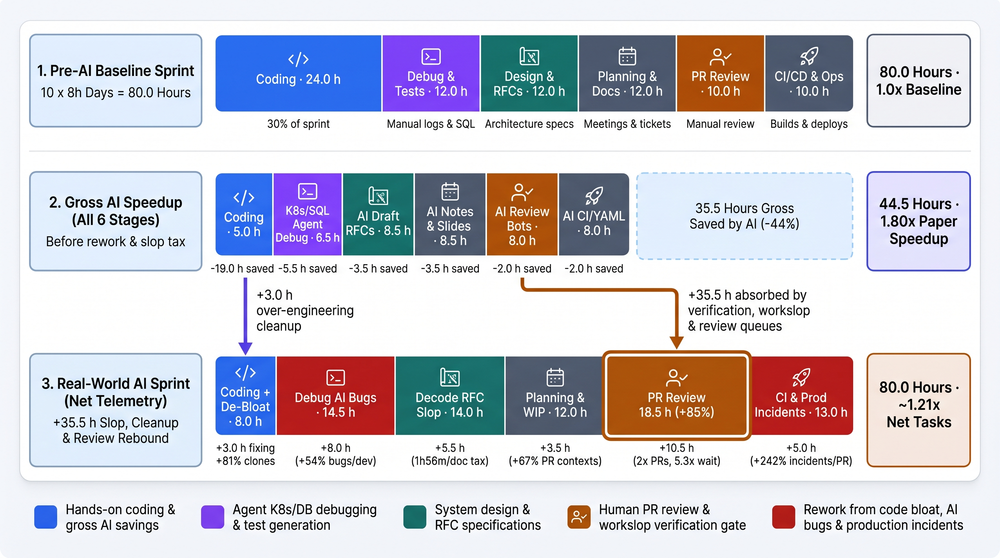
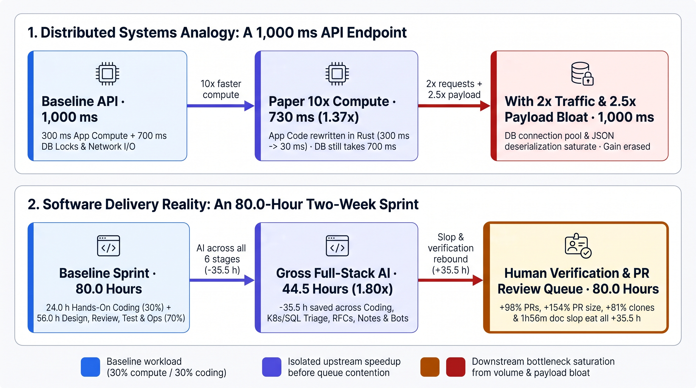
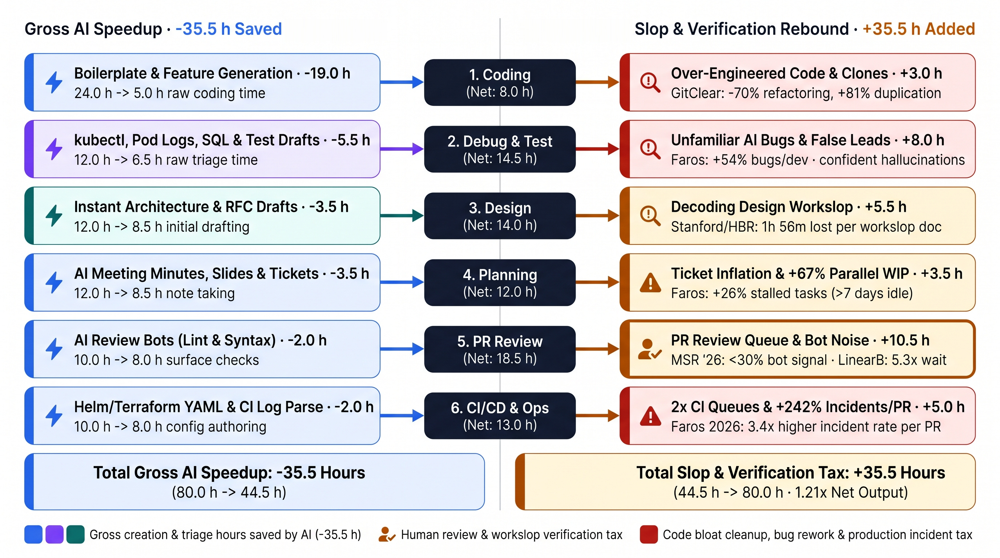
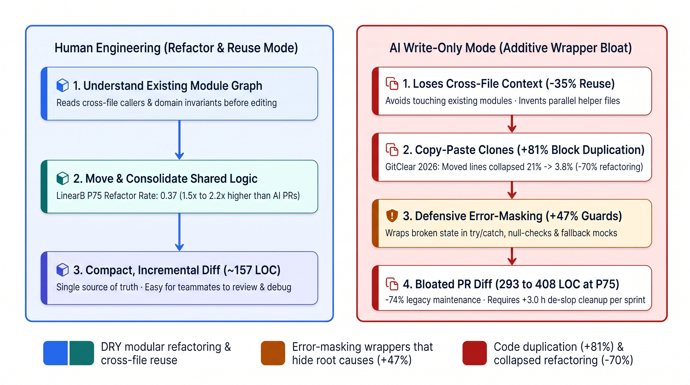
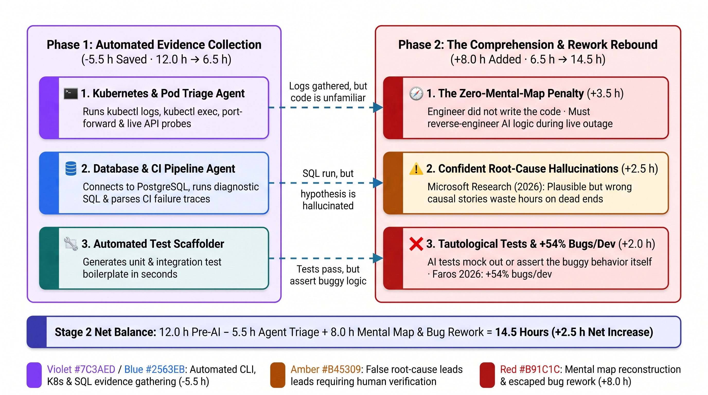
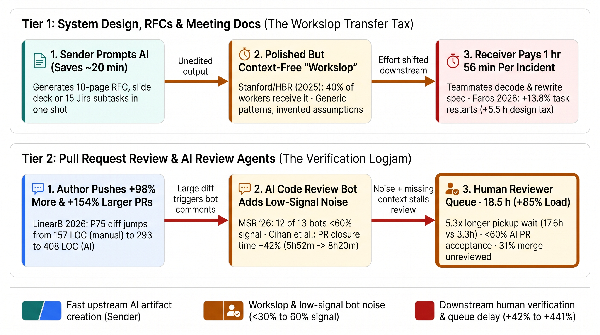
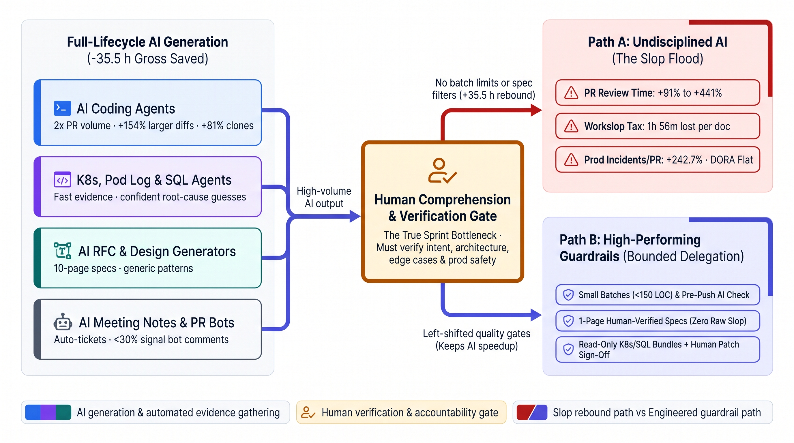

# If We Use AI for Coding, Debugging, Design, and Code Reviews, Why Isn't Our Sprint 10× Faster?

### A stage-by-stage telemetry analysis of an 80-hour (`10 × 8h`) software engineering sprint across 623 million lines of code, 8.1 million pull requests, and 22,000 developers

When someone asks why AI coding assistants haven't made software engineering teams 10 times faster, the standard answer goes like this: *"Developers only spend 20% to 30% of their week writing code. Even if AI makes coding 10× faster, the other 70% of the sprint stays the same."*

In 2023, when AI meant single-line autocomplete inside an IDE, that explanation was good enough. In 2026, it no longer holds up.

Walk past a senior engineer's desk today and look at how they actually work. They are not just using AI to type functions. When a staging pod crashes, they do not manually dig through dashboards for an hour. Instead, they point an agent (`Claude Code`, `Cursor`, or an MCP-connected assistant) at the cluster. The agent runs `kubectl get pods`, tails the container logs, executes commands inside the pod, port-forwards the service, sends test payloads, connects to PostgreSQL, and runs diagnostic SQL queries to isolate the bad row. When a new business requirement arrives, engineers ask an LLM to draft the system design RFC and sequence diagrams. When a pull request opens, an automated AI code-review bot (`CodeRabbit`, `GitHub Copilot Review`, `Qodo`) posts comments within seconds. Even sprint planning, meeting minutes, and status slide decks are generated by AI.

Engineers now use AI across **every single stage of the software development lifecycle (SDLC)**, including coding, debugging, testing, system design, sprint planning, code review, and CI/CD operations. So why aren't engineering teams shipping 5× or 10× faster?

To answer that properly, we cannot rely on anecdotes or vendor benchmarks. We have to look at what large-scale production telemetry and empirical studies actually measured across the industry in 2025 and 2026.

The data reveals a plot twist that every systems engineer will recognize immediately. **Using AI across all six stages of a two-week (`80-hour`) sprint genuinely saves `~35.5 hours` of raw creation and log-triage time (`80.0 h → 44.5 h`). Then, it adds `+35.5 hours` right back in verification, over-engineering cleanup, and "workslop" tax (`44.5 h → 80.0 h`).**


*Figure 1: Across a two-week sprint (`10 days × 8 hours = 80.0 hours`), full-lifecycle AI cuts gross creation and triage time to `44.5 hours` (`-35.5 h` saved), before over-engineered code cleanup, AI bug triage, design workslop, and doubled pull-request review queues refill all `80.0 hours`.*

---

## 1. The Systems Engineering Mechanism: The Pipeline Bottleneck Rule

In software engineering, you do not need a 1960s mainframe paper or an airline flight analogy to understand why local speedups fail to multiply end-to-end throughput. You see the exact mechanism every time you profile a distributed system under load.

In operations research, Eliyahu Goldratt called this the **Theory of Constraints**. In backend and platform engineering, we know it as the **Pipeline Bottleneck Rule**:

> **An end-to-end delivery pipeline only moves as fast as its slowest stage. Accelerating stages upstream of the constraint does not increase system throughput. It only builds a deeper work-in-progress (WIP) queue in front of the bottleneck.**

### Stage A: The Isolated 1,000 ms API Endpoint

Imagine a backend API endpoint with a P95 latency of **`1,000 ms`**:
- **`300 ms` (30%):** Application compute logic running in Python or Node.js.
- **`700 ms` (70%):** Database lock acquisition, SQL query execution, third-party payment gateway calls, and network serialization.

Suppose you rewrite the application compute layer in Rust and make it **10× faster** (`300 ms → 30 ms`). Your endpoint latency does not drop to `100 ms`. It drops to **`730 ms`**:

$$\text{Speedup} = \frac{1000\text{ ms}}{30\text{ ms} + 700\text{ ms}} = \frac{1000}{730} \approx 1.37\times$$

Even if you made application compute **infinitely fast (`0 ms`)**, the endpoint is still mathematically capped at **`700 ms` (`1.43×` faster)**.

### Stage B: What Happens When Upstream Speedup Triggers Volume and Payload Bloat

Now consider what actually happens in production when an upstream service suddenly becomes 10× faster at emitting requests, and you also add caching layers across other stages so raw processing drops to `550 ms`:

1. **Request volume doubles (`2×`):** Because upstream generation is cheap, callers fire twice as many concurrent requests.
2. **Payload size balloons (`2.5×`):** Instead of sending compact, hand-crafted diffs, the upstream generator emits verbose, unpruned JSON payloads.
3. **Noisy retries:** Automated helper agents fire speculative queries that miss the cache and hold database transactions open.

What is the result? Your database connection pool saturates, lock contention spikes, and JSON deserialization CPU time doubles. Your end-to-end P95 latency climbs right back to **`1,000 ms`**, or starts throwing `503 Service Unavailable` timeouts.


*Figure 2: Optimizing upstream compute by 10× yields a `1.37×` ceiling when downstream stages are static (middle), and erases the latency gain entirely when faster generation triggers `2×` request volume and `2.5×` larger payloads that saturate the downstream constraint (right).*

In a software engineering sprint, **AI is the upstream generator**, **pull requests, design docs, and test suites are the payloads**, and **human comprehension is the database connection pool**. That human gate has to verify intent, architecture, and production safety before anything can ship.

In short: when AI makes *generating* code, docs, queries, and comments nearly free, **human verification** becomes the hard bottleneck for the entire engineering organization.

---

## 2. How Engineers Actually Spend Their Week (Baseline Data)

Before modeling AI's impact on a sprint, we need an accurate baseline of where software engineers spend their time. Three large-scale studies establish this baseline:

- **[Atlassian's 2025 State of DevEx Report](https://www.atlassian.com/blog/bitbucket/devex-bitbucket-pipelines-versus-jenkins) (thousands of developers):** Developers spend only **16% of their workweek writing code**. The remaining **84%** goes to searching for context, reviewing code, debugging, attending meetings, and resolving technical debt. Furthermore, **50% of developers** report losing **10+ hours per week** (`25%` of a 40-hour week) to organizational and tooling friction.
- **[Microsoft Research's *Time Warp* Study](https://www.microsoft.com/en-us/research/wp-content/uploads/2024/11/Time-Warp-Developer-Productivity-Study.pdf) (`n=482` developers):** When tracking actual workweeks, pure coding accounted for **`~11%`** of developer time (versus `~20%` in their "ideal" week), alongside Communication and Meetings (`~12%`), Debugging (`~9%`), Architecting and Designing Systems (`~6%`), Pull Request Reviews (`~5%`), plus testing, security/compliance, and operational support.
- **[A 2026 study from Oregon State University and Microsoft Research](https://arxiv.org/pdf/2604.07830) (*"To Copilot and Beyond: 22 AI Systems Developers Want Built"*, `n=860` Microsoft engineers):** Researchers confirm that writing code accounts for roughly **one-tenth of a developer's day**. The remaining ~90% lives in debugging production incidents, reviewing changes, keeping documentation from drifting, navigating compliance, and aligning designs.

To give hands-on coding the fairest possible weight in our model, let us allocate a generous **30% of the sprint (`24.0 hours` out of `80.0 hours`, or 3 full days out of 10)** to hands-on coding and initial unit-test authoring. We then divide the remaining **56.0 hours (7 days)** across the other five core engineering activities.

---

## 3. The 80-Hour (`10 × 8h`) Two-Week Sprint Model: Gross Speedup vs. Net Reality

Let us model a standard two-week sprint (**10 working days × 8 hours = 80.0 hours per engineer**) across four columns:
1. **Pre-AI Baseline (`80.0 h`):** Traditional engineering workflow.
2. **Naive "Coding-Only" 10× Math (`58.4 h`):** The classic thought experiment where only coding speeds up by 10× (`24.0 h → 2.4 h`) and nothing else changes (`80.0 / 58.4 = 1.37×`).
3. **Full-Lifecycle Gross AI Speedup (`44.5 h`):** What happens when an engineer uses modern AI agents across **all six stages** of the sprint, measuring only the time saved during creation and automated triage (`-35.5 hours` saved, or **`1.80×` faster** before rework).
4. **Real-World Full-Stack AI Sprint (`80.0 h`):** What production telemetry actually records once the **Slop, Over-Engineering, and Verification Rebound (`+35.5 hours`)** hits each stage.

| Sprint Stage (10 × 8h = 80h) | 1. Pre-AI Baseline | 2. Gross AI Speedup (All 6 Stages) | 3. Slop, Rework & Review Tax | 4. Net Real-World AI Sprint | Net Change vs. Pre-AI |
|---|---|---|---|---|---|
| **1. Hands-on coding & refactoring** | `24.0 h` (`30.0%`) | `5.0 h` (`-19.0 h` saved) | `+3.0 h` (de-bloating clones/wrappers) | **`8.0 h`** (`10.0%`) | **`-16.0 h` (`-67%`)** |
| **2. Debugging, K8s/DB triage & tests** | `12.0 h` (`15.0%`) | `6.5 h` (`-5.5 h` saved) | `+8.0 h` (no mental map, `+54%` bugs) | **`14.5 h`** (`18.1%`) | **`+2.5 h` (`+21%`)** |
| **3. System design & architecture RFCs** | `12.0 h` (`15.0%`) | `8.5 h` (`-3.5 h` saved) | `+5.5 h` (`1h 56m` doc slop, restarts) | **`14.0 h`** (`17.5%`) | **`+2.0 h` (`+17%`)** |
| **4. Sprint planning, meetings & slides** | `12.0 h` (`15.0%`) | `8.5 h` (`-3.5 h` saved) | `+3.5 h` (ticket bloat, `+67%` PR WIP) | **`12.0 h`** (`15.0%`) | **`0.0 h` (`0%`)** |
| **5. PR code review & approval gate** | `10.0 h` (`12.5%`) | `8.0 h` (`-2.0 h` saved) | `+10.5 h` (`2×` PRs, `+154%` size, bots) | **`18.5 h`** (`23.1%`) | **`+8.5 h` (`+85%`)** |
| **6. CI/CD pipelines, deploy & prod ops** | `10.0 h` (`12.5%`) | `8.0 h` (`-2.0 h` saved) | `+5.0 h` (CI queues, `+242.7%` incidents) | **`13.0 h`** (`16.3%`) | **`+3.0 h` (`+30%`)** |
| **Total Sprint Time / Net Output** | **`80.0 h` (`1.00×`)** | **`44.5 h` (`1.80×` paper)** | **`+35.5 h` rebound** | **`80.0 h` (`~1.21×` tasks)** | **Bottleneck shifted** |

*(Note for Medium publishing: Medium does not render native Markdown tables. Below is the exact list formatting you can paste directly into the Medium editor if you do not embed the table as an image.)*

- **Stage 1 (Hands-on coding & refactoring):** `24.0 h` Pre-AI → `5.0 h` Gross AI (`-19.0 h` saved) → `+3.0 h` de-bloating over-engineered code → **`8.0 h` Net (`-16.0 h` saved)**
- **Stage 2 (Debugging, K8s/DB triage & testing):** `12.0 h` Pre-AI → `6.5 h` Gross AI (`-5.5 h` saved) → `+8.0 h` debugging unfamiliar AI code & false leads → **`14.5 h` Net (`+2.5 h` increase)**
- **Stage 3 (System design & architecture RFCs):** `12.0 h` Pre-AI → `8.5 h` Gross AI (`-3.5 h` saved) → `+5.5 h` decoding verbose AI design "workslop" → **`14.0 h` Net (`+2.0 h` increase)**
- **Stage 4 (Sprint planning, meetings & slides):** `12.0 h` Pre-AI → `8.5 h` Gross AI (`-3.5 h` saved) → `+3.5 h` ticket inflation & parallel WIP switching → **`12.0 h` Net (`0.0 h` change)**
- **Stage 5 (PR code review & approval gate):** `10.0 h` Pre-AI → `8.0 h` Gross AI (`-2.0 h` saved) → `+10.5 h` reviewing `2×` more, `+154%` larger PRs + bot noise → **`18.5 h` Net (`+8.5 h` increase)**
- **Stage 6 (CI/CD pipelines, deploy & prod ops):** `10.0 h` Pre-AI → `8.0 h` Gross AI (`-2.0 h` saved) → `+5.0 h` CI contention & `+242.7%` prod incidents/PR → **`13.0 h` Net (`+3.0 h` increase)**
- **Sprint Total:** `80.0 h` Pre-AI → `44.5 h` Gross AI (`-35.5 h` saved) → `+35.5 h` Verification & Slop Rebound → **`80.0 h` Net (`+21%` to `+34%` completed tasks; company-wide DORA lead time flat)**


*Figure 3: Every stage of the sprint experiences a genuine gross speedup from AI tools (`-35.5 hours` on the left), which is offset by a stage-specific verification, cleanup, and queue rebound (`+35.5 hours` on the right).*

---

## 4. Deep Dive: What Speeds Up and What Breaks in Every Stage of the Sprint

Let us examine the exact mechanics and empirical evidence behind each of the six stages.

---

### 4.1 Stage 1: Hands-On Coding (`24.0 h → 5.0 h Gross → 8.0 h Net`)

**What it is:** Writing new application logic, data models, API endpoints, migrations, and refactoring existing modules inside the IDE.

#### Where AI Speeds Things Up (`-19.0 hours`)
Coding assistants and autonomous IDE agents (`Cursor`, `Claude Code`, `GitHub Copilot`, `Windsurf`) dramatically compress the time required to turn a known specification into working syntax. Writing boilerplate, CRUD endpoints, data transformations, and SDK integrations drops from `24.0 hours` to roughly **`5.0 hours`** of prompting, context feeding, and steering (`-19.0 hours` saved).

#### Why It Rebounds (`+3.0 hours` De-Bloat Tax + Massive Downstream Debt)
When a human senior engineer adds a feature to an existing service, they typically inspect neighboring files, extract shared logic into a common helper, and modify existing functions in place (**refactoring**).

LLMs do not naturally work that way. An LLM's context window is finite, and modifying shared abstractions carries a risk of breaking callers outside that window. As a result, **AI strongly biases toward additive, "write-only" code**. It leaves existing functions untouched, duplicates blocks across files, wraps calls in redundant abstraction layers, and silences errors with defensive `try/catch` blocks or fallback mocks.

Two massive longitudinal code-quality studies quantified this structural shift in 2025 and 2026:

- **[GitClear's 2026 Maintainability Gap study](https://www.gitclear.com/the_ai_code_quality_maintainability_gap) (623 million analyzed code changes from 2023 to 2026, building on [their 2025 analysis of 211 million lines](https://www.gitclear.com/ai_assistant_code_quality_2025_research)):**
  - **Refactoring collapsed `-70%`:** The share of changed lines classified as "moved" (the signature of modular refactoring and code consolidation) fell from **`21.0%` in 2022** to **`13.0%` in 2023**, and plunged to **`3.8%` in 2026**.
  - **Long-term legacy code maintenance dropped `-74%`** compared to 2022 baselines, and **cross-file function reuse fell `-35%`**.
  - **Duplicated code blocks jumped `+81%`:** Repeated blocks of five or more consecutive lines climbed from `40.3` to `73.0` per million changed lines (an all-time high), while **within-commit copy/paste rose `+41%`** (`9.4% → 15.7%`). Developers are now **~5× more likely** to copy/paste redundant code than to refactor.
  - **Error-masking constructs rose `+47%`:** [GitClear's live signal graphs](https://www.gitclear.com/industry_stats/ai_code_quality_signal_graphs) show AI commits contain `47%` more defensive idioms (`rescue`, `try/catch` swallowing exceptions, safe-navigation null guards, and mock fallbacks) that make broken state fail silently.
  - **Two-week code churn rose `+15%`:** More lines are reverted or rewritten within 14 days of being authored.
- **[LinearB's 2026 Software Engineering Benchmarks Report](https://assets.linearb.io/image/upload/v1765300694/resources/LinearB_2026_Software_Engineering_Benchmarks_Report.pdf) (8.1 million PRs across 4,813 teams):**
  - **Human PRs refactor `1.5×` to `2.2×` more than AI PRs:** At the 75th percentile (P75), unassisted human PRs have a **Refactor Rate of `0.37`**, compared to **`0.22` for AI-Assisted PRs** and **`0.17` for Agentic AI PRs**.
  - **PR diffs are `87%` to `160%` larger:** At P75, unassisted PRs modify **`157 lines of code`**, whereas Agentic AI PRs hit **`293 lines`** and AI-Assisted PRs hit **`408 lines`**.

As one engineer (`P208`) in the [2026 Microsoft Research and Oregon State University study](https://arxiv.org/pdf/2604.07830) put it:
> *"We want/need [AI] to do a MUCH better job of analyzing a current code base, architecture, and structure so it can understand how/where to add/extend. Today it loves to duplicate code, and even break existing functionality."*

Even when a diligent engineer spends **`+3.0 hours`** inside the coding stage stripping out dead wrappers and collapsing duplicate helpers (bringing net coding time to **`8.0 hours`**, still a **`3.0×` speedup** over `24.0 hours`), the remaining additive bloat flows directly into Debugging (Stage 2) and PR Review (Stage 5).


*Figure 4: Human engineers consolidate shared logic (`0.37` refactor rate, `157 LOC` at P75), whereas AI coding tools default to additive "write-only" generation (`-70%` refactoring, `+81%` block duplication, `+47%` error-masking guards, and `293 to 408 LOC` diffs).*

In short: AI makes raw code authoring `~3×` to `5×` faster, but shifts the codebase from modular refactoring to additive duplication.

---

### 4.2 Stage 2: Debugging, K8s/DB Agent Triage & Testing (`12.0 h → 6.5 h Gross → 14.5 h Net`)

**What it is:** Investigating staging/production bugs, inspecting Kubernetes pods and logs, querying databases, reproducing failures, and writing unit and integration tests.

#### Where AI Speeds Things Up (`-5.5 hours`)
Modern engineers rarely debug from a blank terminal. Using CLI agents (`Claude Code`, `Cursor` agent mode, or custom MCP servers), an engineer can paste a stack trace or alert and let the agent:
1. Run `kubectl get pods`, `kubectl describe`, and `kubectl logs` across namespaces.
2. Execute diagnostic commands inside containers (`kubectl exec`) or open local port-forwards (`kubectl port-forward`) to curl live endpoints.
3. Connect to staging or read-replica databases, inspect table schemas, and run SQL queries to verify data state.
4. Parse CI/CD failure logs and generate unit or integration test suites.

This automated evidence gathering cuts raw log-hunting and test-scaffolding time nearly in half, from `12.0 hours` down to **`6.5 hours` (`-5.5 hours` saved)**. In [Microsoft Research's 2026 survey of 860 developers](https://arxiv.org/pdf/2604.07830), **`40.6%` of infrastructure respondents** and **`19.5%` of development respondents** ranked automated incident evidence correlation as one of the highest-value uses of AI: *"There are lots of logistics that need to be done... if those are done by AI, it would be a great win."*

#### Why It Rebounds (`+8.0 hours` Mental Map, Hallucination & Bug Tax)
If AI makes log gathering and test writing `5.5 hours` faster, why does total debugging and testing time *increase* from `12.0 hours` to **`14.5 hours` (`+2.5 hours` net)**? Three mechanisms drive an **`+8.0 hour` rebound**:

1. **The Zero-Mental-Map Penalty (`+3.5 hours`):**
   When you write a 300-line service by hand, you build an internal mental map of its state transitions, locking assumptions, and edge cases while typing. When an AI agent writes those 300 lines in 30 seconds, **nobody on the team has that mental map**. When a subtle race condition or data-corruption bug triggers in staging three days later, you are not debugging *your* code. You are reverse-engineering a stranger's code under incident pressure. Plus, because [GitClear's 2026 telemetry](https://www.gitclear.com/the_ai_code_quality_maintainability_gap) found AI increases **error-masking constructs by `+47%`** (swallowed exceptions and silent fallback values), the crash happens far downstream from where the state was actually corrupted.
2. **Confident Root-Cause Hallucinations (`+2.5 hours`):**
   Agents are fast at collecting `kubectl` logs and SQL rows, but notoriously unreliable at causal root-cause reasoning across distributed services. When an agent correlates three log lines and presents a plausible-sounding (but wrong) root-cause hypothesis with 100% confidence, engineers waste hours chasing a phantom bug. As one Microsoft engineer (`P223`) explained in the [To Copilot and Beyond study](https://arxiv.org/pdf/2604.07830):
   > *"AI is very bad at understanding the context and throwing wrong answers with utmost confidence, makes us waste time instead of helping."*
3. **Tautological Unit Tests & Rising Bug Density (`+2.0 hours`):**
   In that same [Microsoft Research study](https://arxiv.org/pdf/2604.07830), **`44.5%` of respondents** in the testing track highlighted a critical flaw in AI test generation. When you ask an LLM to write unit tests for code it just generated, it reads the implementation (including its bugs) and writes tests that assert the buggy behavior, or mocks out the exact database/network boundary where the bug lives. The test suite shows `100%` green coverage in CI while leaking defects.
   - **Rising Bug Rates in Production Telemetry:** In [Faros AI's July 2025 study of 10,000+ developers](https://243608892.fs1.hubspotusercontent-na2.net/hubfs/243608892/AI_Engineering_Impact_Report_July_2025_Faros_AI.pdf), high AI adoption correlated with a **`+9%` increase in bugs per developer**. In [Faros AI's 2026 follow-up across 22,000 developers](https://www.faros.ai/blog/key-takeaways-from-the-dora-report-2025), **bugs per developer surged to `+54%`**.


*Figure 5: Agents save `5.5 hours` automating `kubectl`, pod logs, SQL queries, and test scaffolding (left), but add `8.0 hours` back because engineers must debug unfamiliar AI code without a mental map, verify confident false root-cause hypotheses, and fix `+54%` more escaped bugs (right).*

In short: AI agents automate the *logistics* of debugging (`kubectl`, SQL, log search), but AI-authored code produces `54%` more bugs that take longer to diagnose because no human holds the mental model.

---

### 4.3 Stage 3: System Design & Architecture RFCs (`12.0 h → 8.5 h Gross → 14.0 h Net`)

**What it is:** Translating business requirements into system architecture, API contracts, database schemas, Request for Comments (RFC) design documents, and trade-off analyses.

#### Where AI Speeds Things Up (`-3.5 hours`)
Instead of staring at a blank page, an engineer feeds product requirements and existing schema files into an LLM and asks for an RFC draft, sequence diagrams, and failure-mode tables. Initial drafting drops from `12.0 hours` to **`8.5 hours` (`-3.5 hours` saved)**.

#### Why It Rebounds (`+5.5 hours` "Workslop" & Spec-Restart Tax)
Here we encounter one of the most destructive phenomena documented in recent workplace research: **AI-generated "workslop."**

In September 2025, researchers from **Stanford University's Social Media Lab and BetterUp Labs** published a [landmark study in *Harvard Business Review*](https://hbr.org/2025/09/ai-generated-workslop-is-destroying-productivity) (with full data in the [BetterUp and Stanford research report](https://www.betterup.com/hubfs/Post-Uplift%20content/BetterUp_Uplift_The%20hidden%20cost%20of%20workslop.pdf)) surveying **1,150 full-time U.S. desk workers**:

- **Definition of Workslop:** AI-generated content (such as design documents, technical reports, slide decks, summaries, and code) that looks polished, structured, and complete at a glance, but lacks the project-specific context, constraints, and substance required to actually advance the task.
- **Prevalence:** **40% of workers** received workslop in the prior month (`53%` admitted to sending it at least occasionally, and **`15.4%` of all incoming work** at organizations was estimated to be workslop).
- **The Transfer Tax (`1 hour 56 minutes` per incident):** As the Stanford and BetterUp researchers explain, *"The insidious effect of workslop is that it shifts the burden of the work downstream, requiring the receiver to interpret, correct, or redo the work. In other words, it transfers the effort from creator to receiver."* On average, recipients spent **1 hour and 56 minutes per workslop incident** decoding, verifying, and rewriting the material.
- **Erosion of Engineering Trust:** Among recipients of workslop, **`54%`** viewed the sender as less creative, **`50%`** as less capable, **`49%`** as less reliable, and **`42%`** as less trustworthy.

In software architecture, design workslop is especially costly:
- **Generic Textbook Patterns & Silent Assumptions:** In [Microsoft Research's 2026 study](https://arxiv.org/pdf/2604.07830), engineers noted that when asked to design a system, LLMs default to verbose, generic patterns that ignore local infrastructure constraints (*"AI would probably fall back to using the same known pattern regardless of the design particularities. That makes the designs inefficient"*) and silently invent requirements or hallucinate guarantees.
- **`+13.8%` More Task Restarts:** When an engineer prompts a 10-page RFC in 10 minutes without deeply thinking through edge cases, teammates either spend hours in design review stripping out the fluff and verifying assumptions, or approve it superficially. [Faros AI’s 2026 telemetry](https://www.faros.ai/blog/key-takeaways-from-the-dora-report-2025) found that **task restarts** (tickets that move backward to *in-progress* after hitting an architectural dead end) **increased by `+13.8%`**.

Decoding bloated AI RFCs (`~2 hours` per doc across 2 to 3 specs per sprint) plus re-architecting restarted tasks adds **`+5.5 hours`** back, pushing net design time from `12.0 hours` to **`14.0 hours` (`+2.0 hours` net increase)**.

In short: prompting a 10-page design doc saves the author 30 minutes and costs the rest of the engineering team 2 hours to read, fact-check, and rewrite.

---

### 4.4 Stage 4: Sprint Planning, Meetings & Presentations (`12.0 h → 8.5 h Gross → 12.0 h Net`)

**What it is:** Sprint planning, backlog refinement, daily standups, writing meeting minutes, preparing architecture/demo slide decks, and updating documentation.

#### Where AI Speeds Things Up (`-3.5 hours`)
AI meeting transcription bots summarize 60-minute calls automatically, presentation tools generate slide decks from bullet points, and task agents break high-level epics into Jira subtasks. That trims roughly **`3.5 hours`** of manual note-taking and slide formatting (`12.0 h → 8.5 h`).

#### Why It Rebounds (`+3.5 hours` Document Inflation & Multi-Agent Context Switching)
All `3.5 hours` saved in artifact creation are immediately consumed by two new coordination taxes:

1. **Ticket & Documentation Inflation:**
   When generating Jira tickets, status reports, and wiki pages costs zero effort, volume explodes. Instead of a concise 5-line ticket or a 4-bullet meeting decision log, engineers face 15 auto-generated subtasks and 3-page AI meeting transcripts where critical decisions are buried inside generic filler. In the [2026 Microsoft Research survey](https://arxiv.org/pdf/2604.07830), **`45.9%` of respondents** in the Meta-Work track flagged documentation drift and AI doc bloat as a major pain point:
   > *"Unfortunately, I think right now the focus is on just generating a bunch of AI slop that nobody will ever read or maintain, which just makes all the documentation problems we have now even worse."*
2. **Parallel Workstream Explosion (`+67.4%` PR Contexts & `+26%` Stalled Work):**
   Because coding agents can run in the background, developers spin up multiple tasks concurrently. [Faros AI’s 2025 and 2026 telemetry](https://www.faros.ai/blog/key-takeaways-from-the-dora-report-2025) measured the exact operational cost of this multitasking:
   - Developers on high-AI teams interact with **`+47%` more PRs per day** in 2025, rising to **`+67.4%` more PR contexts** and **`+17.7%` more task contexts per day** in 2026.
   - **Stalled tasks (`7+ days` in-progress with zero PR activity) jumped `+26%`**. Starting work with an AI agent is effortless. Finishing, integrating, and shipping all those parallel threads requires extra standup coordination, blocker triage, and re-planning (`+3.5 hours`), leaving net planning and meeting time right back at **`12.0 hours` (`0.0 h` net savings)**.

In short: AI writes the meeting notes and Jira tickets faster, but managing `+67%` more parallel work-in-progress and `+26%` more stalled tickets eats every minute saved.

---

### 4.5 Stage 5: PR Code Review & AI Review Bots (`10.0 h → 8.0 h Gross → 18.5 h Net`)

**What it is:** Reviewing teammates' pull requests, responding to review comments, verifying business logic and security, and waiting for merge approval.

*"Wait,"* many engineers ask, *"if human PR review is the bottleneck, don't AI code review agents (`CodeRabbit`, `GitHub Copilot Review`, `Qodo`, `Cursor Bugbot`, `Greptile`) automate code reviews too?"*

Let us look at what happened when researchers measured AI code review agents (`CRAs`) in real repositories in 2025 and 2026.

#### Where AI Speeds Things Up (`-2.0 hours`)
AI code review bots are genuinely useful as a **first-pass linter**. They summarize diffs, flag obvious null-pointer risks, catch missing error checks, and point out style violations before a human reviewer looks at the PR (`-2.0 hours` saved, `10.0 h → 8.0 h`). In controlled deployments with strict noise filtering, such as the [DeputyDev double-controlled A/B study at TATA 1mg across 200 engineers](https://arxiv.org/html/2508.09676), contextual pre-review reduced per-line review duration.

#### Why It Explodes (`+10.5 hours` from Bot Noise + `2×` Volume + `+154%` Size + `5.3×` Pickup Wait)
Across the broader industry, three empirical and large-scale telemetry studies show why PR code review has become the **#1 bottleneck in modern software engineering**, ballooning from `10.0 hours` to **`18.5 hours` (`+85%` increase)** per sprint:

1. **[An April 2026 MSR study of 3,109 Pull Requests](https://arxiv.org/html/2604.03196) (*"From Industry Claims to Empirical Reality: An Empirical Study of Code Review Agents in Pull Requests"*):**
   Researchers analyzed `19,450` review records across `3,109` PRs from the `AIDev` dataset:
   - Vendor marketing claimed AI review bots could handle `80%` of PRs without human involvement. In reality, PRs reviewed solely by AI Code Review Agents achieved only a **`45.20%` merge rate**, compared to **`68.37%` for human-reviewed PRs** (`23.17 percentage points` lower, $p < 0.001$), and suffered a **`34.88%` abandonment rate** (vs. `21.60%` for humans).
   - Why? **Signal-to-noise analysis** revealed that **`60.2%` of closed bot-reviewed PRs had a `0% to 30%` signal ratio** (fewer than 1 in 3 comments were actionable bugs, security issues, or architectural flaws), and **12 of 13 code review agents (`92.31%`) averaged below `60%` signal** (`Copilot` averaged `19.79%` signal; `github-advanced-security[bot]` `27.62%`; `cursor[bot]` `43.40%`; `entelligence-ai-pr-reviews[bot]` `52.29%`).
   - A [companion MSR 2026 study of 7,416 reviewer-bot comments across 4,532 agentic PRs](https://dl.acm.org/doi/abs/10.1145/3793302.3793599) confirmed that **more bot comments on a PR directly correlated with longer PR resolution times and lower average comment relevance**.
2. **[An industrial study of 4,335 Pull Requests by Bilkent University and Beko](https://arxiv.org/html/2412.18531v2) (*"Automated Code Review In Practice"*):**
   Researchers studied **238 practitioners across 10 industrial projects and 4,335 pull requests** (`1,568` reviewed by an LLM CodeReviewBot built on Qodo PR-Agent and GPT-4):
   - Even though developers marked `73.8%` of bot comments as resolved, **average pull request closure time increased by `+42%`, rising from `5 hours 52 minutes` before the bot to `8 hours 20 minutes` after introducing the bot (`p < 0.001`)**.
   - Developers reported that reading, refuting, or making unnecessary edits to satisfy faulty or context-blind bot comments slowed down merges.
3. **[Faros AI's 22,000-developer telemetry](https://www.faros.ai/blog/key-takeaways-from-the-dora-report-2025) & [LinearB's 8.1M PR benchmarks](https://assets.linearb.io/image/upload/v1765300694/resources/LinearB_2026_Software_Engineering_Benchmarks_Report.pdf):**
   Because AI coding tools allow developers to open **`+98%` more PRs** that are **`+154%` larger**, human reviewers are buried:
   - **PR Review Time surged `+91%`** in [Faros AI's 2025 dataset](https://243608892.fs1.hubspotusercontent-na2.net/hubfs/243608892/AI_Engineering_Impact_Report_July_2025_Faros_AI.pdf) (`10,000+` devs) and **`+441%` (median time in PR review)** in [Faros AI's 2026 dataset](https://www.faros.ai/blog/key-takeaways-from-the-dora-report-2025) (`22,000` devs).
   - **PR Pickup Time is `5.3×` longer:** [LinearB's 2026 study of 8.1M PRs](https://assets.linearb.io/image/upload/v1765300694/resources/LinearB_2026_Software_Engineering_Benchmarks_Report.pdf) found that at P75, **Agentic AI PRs sit idle for `1,055 minutes` (`17.6 hours`)** before a reviewer even opens them, compared to **`496 minutes` (`8.3 hours`)** for AI-Assisted PRs and just **`201 minutes` (`3.35 hours`)** for Unassisted manual PRs.
   - **Low Acceptance & Missing Context:** LinearB found manual PRs merge at **`84.4%`** (with Elite teams above `95%` 30-day acceptance), whereas **AI PRs merge at just `32.7%`** overall, and most teams struggle to exceed a **`60%` acceptance rate**. Engineering leaders surveyed by LinearB explained why:
     > *"AI generates advanced code the author could not explain."*
     > *"Without context it generates more work than a junior developer. The workload increases for the reviewer."*


*Figure 6: In both system design (top) and pull request review (bottom), AI makes artifact generation effortless for the author while transferring a massive verification and noise-filtering burden onto teammates (`1h 56m` per workslop doc; `<30%` bot signal; `5.3×` longer PR pickup wait; `+91%` to `+441%` longer review cycles).*

In short: AI code review bots cannot approve architectural intent, noisy bot comments add `+42%` to PR closure time, and human reviewers face `2×` as many PRs that are `154%` larger. That nearly doubles sprint review hours (`10.0 h → 18.5 h`).

---

### 4.6 Stage 6: CI/CD Pipelines, Deployments & Production Ops (`10.0 h → 8.0 h Gross → 13.0 h Net`)

**What it is:** Maintaining CI/CD workflows, waiting on build/test pipelines, resolving merge conflicts, deploying releases, and handling on-call production incidents.

#### Where AI Speeds Things Up (`-2.0 hours`)
AI assistants save roughly **`2.0 hours`** per sprint (`10.0 h → 8.0 h`) by generating GitHub Actions workflows, Dockerfiles, Helm charts, and Terraform configurations, and by summarizing long CI build failure logs. In [Microsoft Research's 2026 developer survey](https://arxiv.org/pdf/2604.07830), `33.7%` of infrastructure respondents specifically requested CI/CD blueprint and log-diagnosis assistants.

#### Why It Rebounds (`+5.0 hours` CI Queue Contention & `+242.7%` Production Incidents)
1. **CI Pipeline Contention & Merge Conflicts (`+2.0 hours`):**
   When a team merges **`+98%` more PRs** that touch more files per commit (`4.95` to `7.51` files and `293 to 408` lines at P75 in [LinearB's 2026 report](https://assets.linearb.io/image/upload/v1765300694/resources/LinearB_2026_Software_Engineering_Benchmarks_Report.pdf)), CI build queues back up, integration test suites run twice as often, and branches fall out of date faster. Engineers spend extra hours rebasing and resolving merge conflicts.
2. **The "Acceleration Whiplash" in Production (`+3.0 hours`):**
   What happens when reviewers are overwhelmed by `2×` PR volume and `154%` larger diffs? LinearB's qualitative survey and [Faros AI's 2026 telemetry](https://www.faros.ai/blog/key-takeaways-from-the-dora-report-2025) captured the exact failure mode: **reviewer fatigue leads to rubber-stamping.**
   - In Faros AI's 2026 telemetry across `22,000` developers, **`31%` more PRs merged with zero human review at all**.
   - As a direct consequence, **production incidents per PR surged `+242.7%`**. Every merged code change is now **more than `3.4×` as likely to trigger a production incident**.

On-call incident triage, hotfixes, and rollbacks add **`+3.0 hours`** per sprint, bringing net CI/CD and production ops time from `10.0 hours` to **`13.0 hours` (`+3.0 hours` net increase)**.

In short: AI helps write the YAML, but pushing twice as many oversized, lightly reviewed PRs through CI/CD triples the production incident rate per PR.

---

## 5. The Perception Gap: Why `1.21×` Feels Like `10×`

Net completed tasks per sprint only rise by **`+21%` to `+34%` (`1.21× to 1.34×`)**, and company-wide DORA delivery metrics remain flat or suffer stability whiplash. So why do so many developers sincerely feel like they are moving `5×` or `10×` faster?

In [a July 2025 randomized controlled trial by METR](https://metr.org/blog/2025-07-10-early-2025-ai-experienced-os-dev-study/) (with [a February 2026 follow-up](https://metr.org/blog/2026-02-24-uplift-update/)), researchers conducted the most rigorous controlled experiment to date on experienced open-source developers:
- **Study Design:** 16 experienced maintainers working on large, mature open-source repositories they knew deeply (averaging **`22,000+` GitHub stars** and **`1,000,000+` lines of code**) completed **246 real repository issues** (features, bug fixes, refactors averaging 2 hours each). Issues were randomly assigned to either allow frontier AI tools (primarily `Cursor Pro` with `Claude 3.5/3.7 Sonnet`) or disallow AI, with full screen recording.
- **The Perception vs. Reality Gap:**
  - **Before starting:** Developers forecasted that AI would speed them up by **`+24%`**.
  - **After finishing:** Even after completing the tasks, developers believed AI had sped them up by **`+20%`**.
  - **Actual Stopwatch Telemetry:** In the early-2025 RCT, developers using AI actually took **`19% longer`** to complete issues than when working without AI (in the [February 2026 follow-up cohort](https://metr.org/blog/2026-02-24-uplift-update/), estimated speedup shifted to **`4% to 18% faster`**, still nowhere near `2×` or `10×`).

Why do smart engineers misjudge their own stopwatch time by `35` to `40` percentage points?

1. **Creation Has High Dopamine; Verification Has Invisible Drag:**
   Watching an agent generate 400 lines of code, a 10-page RFC, or a complex SQL query in 15 seconds feels magical. Your brain anchors on the 15-second generation burst (`Row 2: 44.5 hours`). You do not mentally bill "AI" when you spend 45 minutes two days later untangling a subtle race condition, resolving a noisy bot comment, or rewriting a hallucinated test (`Row 3: +35.5 hours`).
2. **Mechanical vs. Interpretive Cognitive Load:**
   A [UC Berkeley eye-tracking study highlighted by Google Cloud DORA](https://dora.dev/insights/customization-supports-developer-engagement/) found that developers gave **`19%` of their visual attention** to AI chat during mechanical tasks (writing boilerplate, installing packages), but **less than `1%` visual attention** during complex code interpretation tasks. When deep comprehension was required, engineers chose to read and reason manually to preserve mental control.
3. **Bounded Delegation:**
   In [Microsoft Research's 2026 paper](https://arxiv.org/pdf/2604.07830), the authors name this boundary **"bounded delegation"**: developers want AI to absorb the *assembly and logistics work surrounding their craft* (collecting logs, scaffolding tests, formatting docs), while fiercely protecting human agency over *architectural judgment, design trade-offs, and production approval*.

---

## 6. The Engineering Playbook: How to Keep the `35.5 Hours` AI Saves

The telemetry from Faros AI, LinearB, GitClear, and DORA makes one thing clear: **the `35.5 hours` of gross AI speedup across an 80-hour sprint are real.** The reason teams lose those `35.5 hours` is that they deployed `10×` generation tools without engineering any constraints on **batch size, code reuse, or artifact slop**.


*Figure 7: Without guardrails, full-lifecycle AI generation floods the human verification gate and triggers the Slop Rebound (Path A, top right). High-performing engineering teams enforce Bounded Delegation guardrails to keep the hours AI saves (Path B, bottom right).*

Here are the **five engineering guardrails** that separate high-performing AI teams from teams drowning in review queues:

- **1. Enforce Hard Small-Batch PR Limits (`<150 LOC`) and Stacked Diffs:**
  The [2025 Google Cloud DORA Report](https://cloud.google.com/blog/products/ai-machine-learning/announcing-the-2025-dora-report) and [Faros AI's research](https://www.faros.ai/blog/key-takeaways-from-the-dora-report-2025) identify **working in small batches** as the single strongest amplifier of AI ROI. Never allow an agent to open a 500-line monolithic PR. Configure your agent rules (`CLAUDE.md`, `.cursorrules`) and CI checks to enforce atomic PRs under `150 lines`, stacked sequentially so a human can review each diff in 10 minutes instead of deferring it for `17.6 hours`.
- **2. Put Anti-Bloat & DRY Rules Directly into Agent Instructions:**
  Counteract AI's "write-only" bias documented in [GitClear's 2026 research](https://www.gitclear.com/the_ai_code_quality_maintainability_gap) by explicitly instructing coding agents: *"Search existing modules before creating new files; consolidate shared logic rather than duplicating 5+ line blocks; never add speculative wrapper classes or silent `try/catch` error-masking guards; halt and ask when repository conventions are unclear."* Add automated duplicate-block and complexity tripwires in CI.
- **3. Shift AI Code Review Left to the Author's IDE, Not the PR Queue:**
  As [DORA's 2025 SDLC tension analysis](https://dora.dev/insights/balancing-ai-tensions/) and the [MSR 2026 code review agent study](https://arxiv.org/html/2604.03196) recommend, running noisy general-purpose review bots on open PRs buries reviewers in `<30%`-signal comments and slows PR closure by `+42%`. Instead, run AI pre-review, static analysis, and coverage gap checks **locally in the author's IDE before `git push`**, and restrict PR bots strictly to high-precision security and breaking-change rules.
- **4. Ban Unedited "Workslop" in RFCs, Slides, and Jira Tickets:**
  Stop the `1 hour 56 minute` workslop transfer tax measured in the [Stanford and BetterUp HBR study](https://hbr.org/2025/09/ai-generated-workslop-is-destroying-productivity). Establish a team rule: **you may use AI to explore options and draft, but you may never send teammates raw, uncondensed LLM prose.** Require design RFCs to start with a human-verified 1-page brief stating the exact problem, system boundaries, non-goals, and trade-offs, with every assumption explicitly labeled.
- **5. Use K8s/DB Agents for Read-Only Evidence Bundles, Then Build the Mental Map:**
  Follow the **Trace-to-Diff Workbench** pattern from [Microsoft Research's 2026 study](https://arxiv.org/pdf/2604.07830). Let agents automate read-only `kubectl logs`, pod inspection, trace correlation, and diagnostic SQL queries to assemble a cited incident case file with explicit uncertainty markers. Never let an agent apply an unverified fix or commit tautological unit tests without the engineer first reproducing the fault and verifying the test fails when the fix is reverted.

---

## 7. Limitations: Where AI *Does* Deliver 5× to 10× Speedups

To keep this analysis rigorous, we must bound where the `80-hour` bottleneck model applies and where it does not:

- **Greenfield Prototypes & Zero-to-One MVPs:** When a single engineer is building a brand-new prototype, an internal CLI tool, a benchmark harness, or a disposable proof-of-concept with zero legacy callers, no multi-reviewer queue, and low blast radius, the downstream verification tax is near zero. In those environments, `3×` to `10×` end-to-end speedups are real and routine.
- **Self-Contained Mechanical Migrations:** Well-scoped, deterministic transformations (such as upgrading an SDK across 50 files with an existing high-coverage integration test suite) bypass design ambiguity and human intent review.
- **Production Multi-Engineer Systems (The 90% Case):** Once a codebase has multiple contributors, shared state, customer SLAs, and compliance boundaries, **the Pipeline Bottleneck Rule governs everything**.

---

## 8. Conclusion: The Question to Ask Next Sprint

AI did not fail to speed up software engineering. It succeeded so dramatically at speeding up **artifact generation** (code, SQL queries, test scaffolds, RFC drafts, meeting notes, and review comments) that it starved the one resource in the sprint that cannot be parallelized by tokens: **human comprehension and accountability**.

The next time a vendor, executive, or benchmark claims a new AI model will make your engineering team `10×` faster, do not argue about whether the model can write code `10×` faster.

Show them the `80-hour` sprint breakdown, point to the `35.5 hours` of verification and workslop tax, and ask:

> **"It makes generating code and docs 10× faster. How fast can our team verify, review, and debug what it just generated?"**

---

## Repository Layout

```text
README.md                         Canonical Medium article and full-lifecycle 80-hour sprint analysis
docs/claude-design-brief.md       12-page LinkedIn PDF carousel brief for Claude Design + LinkedIn post copy
docs/nano-banana-prompts.md       10 image generation prompts (7 in 16:9 for article + 3 in 3:4 for carousel)
docs/diagrams/                    Generated 2K diagram images (01..07 for article, li-01..li-03 for carousel)
```

---

## Further Reading & Linked Sources

- [Faros AI (July 2025): The AI Productivity Paradox Report (10,000+ developers across 1,255 teams)](https://243608892.fs1.hubspotusercontent-na2.net/hubfs/243608892/AI_Engineering_Impact_Report_July_2025_Faros_AI.pdf)
- [Faros AI (2026): The Acceleration Whiplash & DORA 2025 Key Takeaways (22,000 developers across 4,000+ teams)](https://www.faros.ai/blog/key-takeaways-from-the-dora-report-2025)
- [LinearB (2026): Software Engineering Benchmarks Report, The AI Productivity Edition (8.1M+ pull requests across 4,813 teams)](https://assets.linearb.io/image/upload/v1765300694/resources/LinearB_2026_Software_Engineering_Benchmarks_Report.pdf)
- [GitClear (2026): The Maintainability Gap, AI Code Quality Research (623M changed lines, 2023 to 2026)](https://www.gitclear.com/the_ai_code_quality_maintainability_gap) and [GitClear (2025): AI Copilot Code Quality Research (211M changed lines)](https://www.gitclear.com/ai_assistant_code_quality_2025_research)
- [Oregon State University & Microsoft Research (2026): To Copilot and Beyond, 22 AI Systems Developers Want Built (n=860 Microsoft engineers)](https://arxiv.org/pdf/2604.07830)
- [Harvard Business Review, Stanford University & BetterUp Labs (Sept 2025): AI-Generated "Workslop" Is Destroying Productivity](https://hbr.org/2025/09/ai-generated-workslop-is-destroying-productivity) and [Full BetterUp × Stanford Report PDF](https://www.betterup.com/hubfs/Post-Uplift%20content/BetterUp_Uplift_The%20hidden%20cost%20of%20workslop.pdf)
- [MSR 2026 Empirical Study: From Industry Claims to Empirical Reality, Code Review Agents in Pull Requests (3,109 PRs)](https://arxiv.org/html/2604.03196) and [MSR 2026 Companion Study on Reviewer Bot Footprints (4,532 PRs)](https://dl.acm.org/doi/abs/10.1145/3793302.3793599)
- [Bilkent University & Beko (2025): Automated Code Review In Practice (238 practitioners, 4,335 PRs)](https://arxiv.org/html/2412.18531v2)
- [METR Randomized Controlled Trial (July 2025): Measuring the Impact of Early-2025 AI on Experienced Open-Source Developer Productivity](https://metr.org/blog/2025-07-10-early-2025-ai-experienced-os-dev-study/) and [METR February 2026 Update](https://metr.org/blog/2026-02-24-uplift-update/)
- [Google Cloud DORA (2025): Balancing AI Tensions Across the SDLC](https://dora.dev/insights/balancing-ai-tensions/) and [DORA / UC Berkeley Study on Customization & Developer Engagement](https://dora.dev/insights/customization-supports-developer-engagement/)
- [Atlassian State of DevEx Report (2025)](https://www.atlassian.com/blog/bitbucket/devex-bitbucket-pipelines-versus-jenkins) and [Microsoft Research Time Warp Developer Productivity Study](https://www.microsoft.com/en-us/research/wp-content/uploads/2024/11/Time-Warp-Developer-Productivity-Study.pdf)
